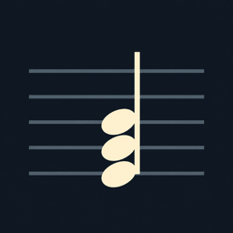
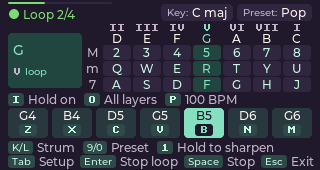

# ZeroChord



**A pocket chord instrument, backing band and looper for CardputerZero. Version 2.0.1.**

ZeroChord turns your CardputerZero into a pocket jam partner. Pick a chord with one hand,
play its notes with the other, and a backing band of Chord, Arp, Pad, Bass and Drums
follows along.

**Catch ideas as they come.** Press `Enter`, play, and press `Enter` again: ZeroChord loops
what you played, in time, with the sounds you played it with. Then jam over it: play a
melody, turn every key into a note by holding `Space`, or plug in a USB MIDI keyboard.
Loops are saved and follow the tempo, so the idea you had on the bus is still there to
work on later.

Inspired by [**minichord**](https://minichord.com/) and the
[**Suzuki Omnichord**](https://www.suzuki-music.co.jp/special/omnichord_om-108/en/).
Seven editable presets, from Dream to Waltz to Dance, give you a starting point; sounds,
envelopes, tempo and swing are adjustable.



[Download ZeroChord 2.0.1](https://github.com/momo20261121/ZeroChord/releases/download/v2.0.1/zerochord_2.0.1_arm64.deb) · [Make your first sound](#make-your-first-sound) · [User guide](docs/USER_GUIDE.md)

## Install

Copy `zerochord_2.0.1_arm64.deb` to the CardputerZero, then run there:

```sh
sudo apt install ./zerochord_2.0.1_arm64.deb
systemctl --user restart APPLaunch.service
```

Open **ZeroChord** from the launcher. The package uses the system sound bank;
APT installs `libpulse0`, `pulseaudio-utils`, and `timgm6mb-soundfont` if needed.
Settings, presets, your loop and sound packs are kept together in `~/ZeroChord/` and
survive updates; ZeroChord 2.0 moves them there from `~/.config/zerochord/`. No
network connection is needed to play once installed.

## Make your first sound

1. Press `8` for a C major chord. The app starts silently until you play.
2. Play `Z` `X` `C` `V` `B` `N` `M` to pick its notes. `L` strums up. `K` strums down.
3. Try `8` → `5` → `T` → `4` for C → G → Am → F in the default key of C.
4. Press `O` for backing layers: `Enter` mutes or unmutes Chord, Arp, Pad, Bass, or
   Drums, and `Z` / `C` set its mix. `Esc` returns to playing. `I` toggles **Hold**.
5. Record a loop: press `Enter`, play `8`, `5`, `T` and `4` for about a bar each, then
   press `Enter` to finish and `Enter` again to hear it loop. Hold `Space` and play a
   melody over it with every key; hold `Space` again to return.
6. Press `Space` to stop sound. Hold `Esc` to return to the launcher.

See the [keyboard reference](docs/USER_GUIDE.md#keyboard-reference) for all shortcuts.

## Using ZeroChord

- [User guide](docs/USER_GUIDE.md): playing, modes, settings, EQ and troubleshooting.
  Press `Tab` and select **About** on the device for the version and a QR code to this repository.
- [Presets](docs/PRESETS.md): sounds, envelopes, defaults and editable files.
- [Front notes](docs/FRONT_NOTES.md): chord/scale modes and per-key mappings.
- [Custom sound packs](sounds/README.md): importing your own SoundFonts.
- [Release notes](CHANGELOG.md).

## For developers

- [Build and release](docs/DEVELOPMENT.md) and [testing](docs/TESTING.md).
- [Design record](docs/DESIGN.md), [audio sourcing](docs/AUDIO_AND_REUSE.md) and the
  [scenario review](docs/SCENARIO_REVIEW.md): dated project notes, not user documentation.

## Acknowledgments

ZeroChord was built with assistance from OpenAI GPT and Anthropic Claude.

- The **minichord** firmware informed chord combinations and how
  a selected chord responds to button releases. [minichord repository](https://github.com/BenjaminPoilve/minichord)
- The M5Stack CardputerZero Community’s built-in **Piano** app was a reference
  for SoundFont playback and device audio. Its repository also supplies the
  separately downloaded Grand Piano sound pack. [CardputerZero Piano repository](https://github.com/CardputerZero/Piano)
- The official **CardputerZero Template** was a reference for the desktop
  simulator and device build. [CardputerZero Template repository](https://github.com/CardputerZero/Template)

ZeroChord's source and original icon are [MIT licensed](LICENSE).
The runtime sound bank has its own license and is supplied separately; see
[third-party notices](THIRD_PARTY_NOTICES.md).
Source code is included in this repository.
