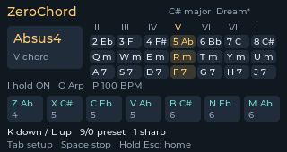

# ZeroChord

A pocket chord-and-harp instrument for CardputerZero, inspired primarily by
[minichord](https://minichord.com/user_manual/) and also by the
[Suzuki Omnichord OM-108](https://www.omnichord-heaven.com/downloads/manuals/OM-108_Owners_Guide.html).

Status: playable 0.1.0 prototype, with an SDL desktop preview and a native Linux
framebuffer/evdev build. Uses LVGL 9.5, TinySoundFont, and miniaudio.



Choose a key and scale, select chords through a three-row keyboard grid, then
pick individual harp notes or trigger strums. Chord roots follow scale degrees;
the rows independently choose major, minor, or dominant seventh quality.

- [Complete presets, individual resets, and editable TOML](docs/PRESETS.md)
- [Controls and musical behavior](docs/DESIGN.md)
- [Testing and device installation](docs/TESTING.md)
- [Audio sourcing, reference projects, and reuse licenses](docs/AUDIO_AND_REUSE.md)
- [Packaging and publishing record](PUBLISH.md)

The original app source is [MIT licensed](LICENSE). The runtime TimGM6mb sound
bank is GPL-2-only and supplied separately by the device's Debian package.
See [third-party notices](THIRD_PARTY_NOTICES.md). This directory has its own Git
repository; no remote or external publication is configured.

## Play

| Chord row | II | III | IV | V | VI | VII | I |
| --- | --- | --- | --- | --- | --- | --- | --- |
| Major | 2 | 3 | 4 | 5 | 6 | 7 | 8 |
| Minor | Q | W | E | R | T | Y | U |
| Dominant 7 | A | S | D | F | G | H | J |

Choose the key/scale with Tab. For I–V–vi–IV, press **8, 5, T, 4**.
Combine rows in one column for maj7, m7, diminished, or augmented chords.
Hold one column and press another for a slash bass.

**Z X C V B N M** play ascending harp notes. **K** strums down, **L** strums up.
**9/0** select the previous/next preset. **I** toggles hold; **O** cycles Pad → Chord → Arp → Front only;
**P** opens a numeric tempo editor (40–240 BPM). Hold **1** when choosing a chord to sharpen its root.
**Space** stops all sound. **Tab** opens settings; **←/→** switches Style/App tabs and
**↑/↓** selects a row. **Enter** opens a choice list; **Enter** confirms
and **Esc** cancels. **F/X** and **Z/C**, the device's printed arrows, also work
throughout settings, including nested editors and choice lists. Short **Esc** goes back; holding
**Esc** for 800 ms exits. System Home/forced quit is handled by the launcher;
SIGINT and SIGTERM also cleanly stop audio.

**Style → Pad sound** and **Chord sound** are independent; Arp uses Chord sound.

The **O** modes change what a chord button (for example **8**) plays:

- **Front only:** chord buttons select harmony silently; Z–M and K/L play it.
- **Pad:** a continuous background chord while Hold is on.
- **Chord:** all notes strike together with a clear attack and falling envelope.
  Manual hit plays once per press; optional rhythmic patterns repeat the chord.
- **Arp:** rhythmic chord tones repeat, with Up/Down/Up-down, alternating bass,
  Pop, R&B, Rock, Waltz, and Bossa choices. Up at 100 BPM starts a note every 300 ms.

**K/L** strum the front notes or shift their octave, configured per front-note
mode in **App → Front notes → All**. The backing sound stays separate. Space stops everything and preserves the mode.
Pad motion can be Steady, Slow swell, Breathe, or Pulse.

Nine complete factory presets: Dream, Harp, Keys, Organ, Pop, R&B, Rock, Waltz,
and Bossa. Each includes sounds, BPM, and mode/patterns. Switching recalls its remembered edits. **App** settings contain
Theme, Master/Backing/Front volume, Echo, Hold, Front notes, and
Chord config (Key, shared/per-degree octaves, absolute roots, mappings and recognition timing);
these survive preset switching and restoration.

**Backspace restores the highlighted setting to its preset default.** A `*` marks
customization. **Save as new preset** creates an editable copy; **Restore preset**
resets all musical settings with confirmation. Defaults and remembered edits are
separate TOML files under `~/.config/zerochord/` (or `$XDG_CONFIG_HOME/zerochord/`).
The active legacy setup migrates automatically. Changes save on clean exit;
startup is silent. See the [preset guide](docs/PRESETS.md) for the file format,
app-wide controls, patterns, and restore behavior.

### Customize chord combinations

Open **Tab → App → Chord config → Enter**. **Octave comes first** on All and every degree tab.
All also contains **Key**; each degree has an absolute **Root** override (C–B),
with **Follow Key** to restore its normal degree. Octaves are absolute numbers;
per-degree **Follow All** inherits the shared octave. Changing Key transposes only
default roots, preserving explicit roots and octaves.

 The four combined presses retain
minichord defaults: top+middle = dim, top+bottom = maj7, middle+bottom = m7,
all three = aug. Each can be assigned any chord quality, including **no3**
(root/fifth), **sus2**, and **sus4**. Single-button major/minor/7 rows stay fixed.

- **1** edits the shared mapping for all degrees.
- **←/→** also switches scope tabs.
- **2–8** select **II, III, IV, V, VI, VII, I**, matching the playing keyboard.
- **↑/↓** selects a combination; **Enter** opens its choices. Sound/chord
  choices audition automatically; Enter saves the highlighted choice, Esc cancels.
- Individual degrees start **Inherited**. Choosing a quality makes it **Custom**;
  **Follow All** removes that override. Shared edits preserve custom overrides.
- **↑/↓** selects a mapping; **Enter** opens its editor. Reset actions require a
  confirmation; restore the degree or shared mappings to the app defaults.
  Backspace restores only the highlighted mapping.

Default roots follow Key using major-scale degrees; custom roots are absolute notes.
Front Scale mode has its own major/minor selector. Mappings affect chord, harp, and arp
notes. Releasing part of a combination preserves the selected harmony.
**All → Combination window** groups near-simultaneous chord buttons into one
attack: the trial default is 30 ms, adjustable Off–60 ms in 5 ms steps. Front
notes stay immediate. Longer windows catch more stagger but delay backing more.

## Build locally

Requires Python 3.9+, Git, a C/C++17 compiler, and Make. Dependencies and CMake
stay inside this project:

```sh
python3 -m venv .venv
.venv/bin/python -m pip install cmake==3.31.6
python3 scripts/bootstrap.py
.venv/bin/cmake -S . -B build/desktop -DCMAKE_BUILD_TYPE=Release
.venv/bin/cmake --build build/desktop -j4
```

Copy the device's `/usr/share/sounds/sf2/TimGM6mb.sf2` into
`.tools/soundfonts/TimGM6mb.sf2` for local audio/tests, or pass another compatible
GM bank using `--soundfont PATH` / `ZEROCHORD_SOUNDFONT`. A substituted bank may
sound different and keeps its own license. The bank is not checked into Git.

```sh
build/desktop/M5CardputerZero-ZeroChord
.venv/bin/ctest --test-dir build/desktop --output-on-failure
build/desktop/zerochord-render .tools/soundfonts/TimGM6mb.sf2 build/demo.wav
```

### Build for the device on macOS

```sh
.venv/bin/python scripts/build_device.py
sh scripts/deploy_device.sh
```

The first command installs checksum-verified Zig 0.15.2 inside `.tools/`, then
cross-compiles the Linux ARM64 framebuffer app into `build/cross-device/`.
Compiler caches also stay in `.tools/`; subsequent builds are incremental.
No VM, device sysroot, or system-wide install is required. The target uses glibc
2.36 compatibility and a statically linked C++ runtime. See the
[official Zig downloads](https://ziglang.org/download/) for the compiler source.

Deployment uses the workspace's `ssh_config` and existing development wrapper
at `${HOME}/ZeroChord`. It verifies the transferred binary's checksum, stops
the old preview cleanly so settings save, retains a `.previous` binary, and
reopens the app. A launch failure restores the previous binary. Nothing compiles
on the CardputerZero. This updates the development preview; packaging is separate.

See the [testing guide](docs/TESTING.md) for the device workflow and remaining
hands-on checks.

## Named sounds and front notes

The sound picker offers ten named sounds in Keys, Plucked, Strings, and Pads.
←/→ changes category; ↑/↓ auditions sounds; Enter saves; Esc cancels.
Older saved sounds remain available without expanding the built-in selection.
Pad, Chord/Arp, and Front can each use built-in or imported sounds.

Put `.sf2` files or named packs in `~/ZeroChord/sounds/` on the TF card and restart.
See [custom sound packs](sounds/README.md) for locations, naming, and limits.
In **App → Front notes**, choose Chord notes or Scale notes on the All tab,
configure K/L as Strum or Octave shift, and set each key’s note and actual octave.
←/→ navigates All and Z–M tabs. See [front-note controls](docs/FRONT_NOTES.md).
