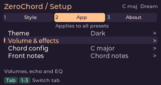

# Presets and customization

A preset remembers its sounds, envelopes, voicings, backing layers and mix, patterns,
tempo, swing, and reverb.
For playing and menu controls, see the [user guide](USER_GUIDE.md).

- [Factory presets](#factory-starting-points)
- [Edit and save on the instrument](#on-the-instrument)
- [Edit preset files](#editable-toml-files)
- [Imported sounds](#imported-sounds)
- [App settings and mixing](#app-settings-and-mixing)

## Factory starting points

Dream is selected on a fresh launch. Press `9` / `0` to try the presets.

Each layer cell gives its sound, pattern, and mix; Chord and Pad also give their
voicing. The Front cell gives its sound and level.

| Preset | BPM / reverb | Chord | Arp | Pad | Bass | Drums | Front |
| --- | --- | --- | --- | --- | --- | --- | --- |
| Dream | 70 / 4.8 s | Slow Strings, Sustained, 37%, Close | Music Box, Up / down, 72% | Halo Pad, Slow swell, 73%, Open | Fretless Bass, Held root, 71% | Standard, Chimes, 100% | Vibraphone, 78% |
| Pop | 100 / 1.5 s | Steel-string Guitar, Pop strum, 79%, Close | Piano, Broken eighths, 67% | Slow Strings, Steady, 41%, Open | Fingered Bass, Driving eighths, 93% | Standard, Pop, 98% | Piano, 73% |
| R&B | 78 / 1.3 s | Electric Piano, Syncopated, 74%, Rich | Vibraphone, Syncopated notes, 77% | Warm Pad, Steady, 51%, Open | Fretless Bass, Syncopated, 100% | Standard, R&B groove, 100% | Alto Sax, 53% |
| Rock | 120 / 1.1 s | Overdriven Guitar, Rock eighths, 85%, Power | Clean Electric Guitar, Up / down, 68% | Organ 3, Steady, 50%, Open | Picked Bass, Driving eighths, 94% | Standard, Rock, 92% | Distortion Guitar, 63% |
| Waltz | 92 / 2.2 s | Piano, Chords on 2 and 3, 88%, Close | Harp, Broken 3/4, 73% | Strings, Slow swell, 55%, Open | Acoustic Bass, Waltz 3/4, 100% | Brush, Waltz 3/4, 70% | Oboe, 47% |
| Bossa | 132 / 1.3 s | Nylon Guitar, Bossa accompaniment, 80%, Close | Vibraphone, Bossa mixed, 65% | Warm Pad, Steady, 48%, Open | Acoustic Bass, Bossa nova, 96% | Jazz, Bossa nova, 95% | Flute, 51% |
| Dance | 124 / 1.8 s | Synth Brass, Offbeat, 88%, Close | Saw Lead, Sixteenths up, 99% | Polysynth, Pulse, 84%, Open | Synth Bass, Offbeat, 100% | TR-808, Four on the floor, 79% | Square Lead, 68% |

Every built-in preset starts with all five layers selected and swing Off. The
styles use only the built-in sound bank, including its drum kits; they do not
use the optional sound packs. Each style also places its parts in the stereo
field and sets how much of each goes to the reverb and the echo: Dream's Music
Box Arp and Vibraphone front echo the most. These pan and send values are in the
exported TOML file. Organ 3, Distortion Guitar, Picked Bass, Fretless Bass, and
Oboe are General MIDI sounds outside the named list; the picker shows them by
the bank's own name in its Saved group. Waltz plays in 3/4 throughout: its
Chord, Arp, Bass, and Drums all use 3/4 patterns.

### Retired presets

Harp, Keys, and Organ were retired in 1.4, and **Dance** joined. A session on a
retired preset opens Dream. Their files from earlier versions stay in
`presets/factory/` and `working/` but no longer load. To keep one, copy its
`presets/factory/` file into `presets/user/` and restart; its remembered edits
in `working/` then apply again.

## On the instrument

Press `Tab` and open **Style**. The tab remembers the last row you selected.
See the [keyboard reference](USER_GUIDE.md#keyboard-reference) for navigation.

- **Preview a change.** `Z` / `C` (← / →) step a number, such as an envelope
  time, and audition it at once. For a sound, pattern, or key, open its list
  with `Enter`; moving to an option auditions it. Leaving the option stops the
  preview. Pattern previews run for up to
  eight seconds. Press `Space` to stop playback, `Enter` to apply the choice,
  or `Esc` to cancel. Layer mutes and mix in **Backing → Layers** apply at once.
- **Reset one setting.** Press `Backspace` on its row. In an open picker,
  `Backspace` highlights the default. Press `Enter` to apply it.
- **Make a copy.** Choose **Save as new preset** and press `Enter` to confirm. This writes a
  copy immediately as User001, User002, and so on. The copied settings become
  its defaults. Edit the TOML `name` to rename it.
- **Start over on a preset.** Choose **Restore preset** and confirm to reset
  the active preset's musical settings. App settings apply across presets.

An asterisk (`*`) marks a preset or setting that differs from its defaults.
Hold `Esc` to exit and save your edits. A forced stop or power loss can lose
edits made since you last saved.




### Tempo, swing, and defaults

Press `P`, or select **Style → Tempo** and press `Enter`. The page has three
rows; ↑/↓ (F/X) move between them.

- **Tempo.** Type a value from 40 to 240 BPM and press `Enter` to apply it.
  `Backspace` deletes digits. Typing a digit on another row returns to Tempo.
- **Swing.** **Off**, **8ths**, or **16ths**. `Enter` or ←/→ (Z/C) step through
  them, and the change applies at once.
- **Swing amount.** ←/→ (Z/C) set 0–100% in 5% steps (default 50%), live. 0% is
  straight and 100% a full triplet feel. The row is dimmed while Swing is Off.

`R` loads the preset tempo for confirmation and the preset swing. `Esc` keeps
swing changes and drops a typed tempo you did not apply. `Backspace` on the
Style Tempo row restores the tempo and swing. The row reads, for example,
**100 BPM** or **100 BPM, 8ths swing 60%**, and the main screen's `P` hint adds
**swing** when it is on. ZeroChord remembers the last preset you used. Stock
defaults upgrade with the app, and customized presets keep their values.

## Sound and envelope order

Style rows are Preset, Tempo, Backing layers, Front sound, Save as new preset,
and Restore preset. **Backing layers** has a Layers tab, then Chord, Arp, Pad,
and Bass tabs with Pattern (Pad: Motion), Sound, and Envelope rows, and a Drums
tab with Kit and Pattern rows. Chord and Pad end with a **Voicing** row.
**Front sound** has Sound, Envelope, and **Level** rows. Level is the front's
level in this style, 0–100% in 5% steps, like a layer mix.
Chord, Arp, and Bass have separate sounds and envelopes. Drums have no envelope.

Each envelope page has Attack, Decay, Sustain, Release, and Restore envelope
rows. ←/→ step a control through its values with a preview; holding repeats.
Enter opens an auditioning choice list; Enter applies the choice and Esc
cancels. Attack, Decay and Release use milliseconds (0–5000). Sustain is 0–100%.
The list includes the sound's own value near middle C, read from the SoundFont,
in numeric order. Choosing it keeps following the sound. **Default** marks the
preset's value. Chord, Arp, and Bass bound slow attacks and long releases for clarity;
explicit envelope values override those bounds. A one-shot sample
still ends when its recorded audio runs out; Sustain cannot make it loop.
Backspace restores one control to the current preset's default. Restore envelope
resets only that part; Restore preset resets only the current preset.

Custom preset TOML accepts optional `front_attack_ms`, `front_decay_ms`,
`front_sustain_percent`, `front_release_ms`, with equivalent `chord_`, `arp_`,
`pad_`, and `bass_` keys. Omitted controls (or -1) use the sound's envelope. Echo is a separate
setting. `arp_sound` / `arp_sound_id` set the Arp sound, and `chord_mix`,
`arp_mix`, and `pad_mix` (0–100, default 100) set the layer mix. A file from
1.2 or earlier without Arp keys keeps using its Chord sound and envelope for Arp.

Bass and drum keys are also optional. `bass` (0 or 1, default 1) mutes or
unmutes the Bass layer and `bass_mix` (0–100) sets its mix. `bass_sound` is a
program (default 33, Fingered Bass), `bass_sound_id` a pack sound, and
`bass_pattern` a pattern ID (default `root`). `drums` (0 or 1, default 1) mutes
or unmutes the Drums layer and `drum_mix` (0–100) sets its mix. Both mixes
default to 0, so a file from 1.3 or earlier stays as it was. `drum_kit` is a kit program in General MIDI drum bank 128
(0 Standard, 8 Room, 16 Power, 24 Electronic, 25 TR-808, 32 Jazz, 40 Brush,
48 Orchestra; default 0). `drum_pattern` takes a pattern ID (below), and
`drum_sound_id` names a sound-pack kit as `pack-folder/sound-id`, with
`drum_kit` as its built-in fallback. The built-in styles leave `drum_sound_id`
out and use the built-in kits.

These keys are optional too:

| Key | Values | Default |
| --- | --- | --- |
| `swing_mode` | `'off'`, `'8ths'`, `'16ths'` | `'off'` |
| `swing_amount` | 0 (straight) to 100 (triplet) | 50 |
| `chord_voicing`, `pad_voicing` | `'close'`, `'open'`, `'power'`, `'rich'` | `'close'` for Chord, `'open'` for Pad |
| `reverb_ms` | Reverb decay time, 300–8000 ms | 1800 |
| `front_mix` | Front level in this style, 0–100 | 100 |
| `<part>_pan` | −50 (left) to 50 (right) | Front 0, Chord −12, Arp 22, others 0 |
| `<part>_reverb` | Reverb send, 0–100 | Front 25, Chord 18, Arp 30, Pad 40, Bass 0, Drums 12 |
| `<part>_echo` | Echo send, 0–100 | Front 100, Chord 25, Arp 60, others 0 |

`<part>` is `front`, `chord`, `arp`, `pad`, `bass`, or `drums`, as in
`arp_pan` or `drums_reverb`. Pan and the sends have no menu rows; set them in
the file. A `swing` key (50–75) from an earlier 1.4 development build is
accepted and ignored.

## Chord roots and front scale

**App → Chord config** starts each scope with **Octave**. The next rows are **Key**
and **Scale** on **All**, and **Root** on a degree tab. For **Root**, choose a note from C to B
or select **Follow Key**.
Default chord roots use the degrees of the Scale: Major, Natural minor, Harmonic
minor, Melodic minor, Dorian, Mixolydian, Lydian, or Phrygian. Custom
roots remain fixed when Key changes. The default octave is 3. Each degree can use an absolute octave or
**Follow All**. These settings apply across presets.

`Backspace` restores the highlighted mapping at its current scope. The
**Restore defaults...** action resets the key or root, octave, and four chord
combinations for that scope after confirmation. On **All**, it also resets
Hold, recognition timing, and degree overrides. See the
[chord configuration reference](FRONT_NOTES.md#chord-config) for details.

App → Front notes → All shows **Key** and **Scale** immediately after Front mode
when Scale notes is selected. Both follow Chord config by default; choosing
either sets the front's own key and scale together, and Backspace follows the
chord again. The front Scale also offers Major pentatonic, Minor pentatonic,
and Blues. Settings from 1.2 keep sounding the same: a front natural-minor
scale becomes its own front key. Front/Backing volume defaults are 100%/80%;
saved user volume values are retained on upgrade.

## Backing layers

**O** opens **Style → Backing layers** on its Layers tab; Esc returns to playing. ↑/↓
(F/X) selects a row in Chord, Arp, Pad, Bass, Drums order. Enter mutes or unmutes the layer,
←/→ (Z/C) changes its mix in 5% steps, and both apply immediately without
restarting the harmony. A layer at 0% is silent; raising a muted layer unmutes
it, and unmuting a 0% layer restores an audible level. Backspace restores the
layer's preset mix and mute state. With every layer muted or silent, **Front
only** selects harmony silently for Z–M/K/L. Hold still controls whether the
harmony remains selected. Built-in presets select all five layers. When all
five play, the Style row, the `O` hint, and the preset list read **All layers**.

**Chord** uses its own sound and envelope. Manual hit strikes once per chord selection;
Sustained holds the chord without retriggering. Every beat, Every eighth,
Offbeat and Syncopated trigger simultaneous chord notes. Pop strum plays down,
down-up, up-down-up; Rock eighths drives eighths accented on 1 and 3. Bass/chord
3/4 plays low bass then two upper chord hits, and Chords on 2 and 3 plays only
the two upper hits of a 3/4 bar, leaving beat 1 to the Bass. Bossa accompaniment
alternates low root/fifth under syncopated upper chords. Bass events are voiced
an octave lower. Steel-string and electric guitar, harp, and plucked ethnic-string
sounds (programs 25–31, 46, and 104–107) strum their chord notes: down on the beat,
and up, quicker and softer, on offbeat eighths. Nylon guitar stays fingerpicked.

**Voicing** sets how Chord and Pad spread the chord's upper notes. Close starts
near middle C and moves each note to the nearest note of the next chord. Open
spreads the notes wide. Power plays root, fifth, and octave. Rich adds 9ths and
7ths and leaves out the root. While the Bass layer plays, full Chord and Pad hits
leave the root to the bass; power chords and a pattern's lone root keep it.

**Arp** uses its own sound and envelope and has its own pattern clock.
Up, Down, Up / down, Root and upper notes and Broken eighths use flowing 95% gates.
Up / down repeats its endpoint notes at each turnaround to make a regular
four-beat phrase. Syncopated notes deliberately includes rests. Broken 3/4 plays
the root, then upper notes, in a 3/4 bar, and is listed for every preset.
Sixteenths up rises in fast 16th notes; Two octaves climbs root, third, and fifth
over two octaves. The legacy mixed Root/fifth and chord and Bossa mixed patterns
retain their IDs and are listed only when the current setup or its preset uses
them, as Bossa does. The Arp plays an octave above the chord.

**Bass** uses its own sound and envelope and plays the chord's root, or its
slash bass, an octave or two below, with its root kept between E1 and E3. Root notes,
Held root, Root and fifth, Driving eighths, Octave pulse, Offbeat, Syncopated, and
Bossa nova are one 4/4 bar; Waltz 3/4 is two 3/4 bars (root, then fifth). Like
Chord and Arp, Bass stops when the chord is released without Hold.

**Drums** plays a General MIDI kit on the same beat clock while a chord sounds.
It has no envelope or key and ignores the chord's notes; Hold keeps it going and
Space stops it. Drum hits ring out on their own when the chord stops.

| Drum pattern | What it plays |
| --- | --- |
| Basic beat | Kick on 1 and 3, snare on 2 and 4, eighth hi-hats |
| Pop | Pushed kick, snare and clap, 16th hi-hats, open hat on 4& |
| Rock | Heavy kick and snare under a driving ride |
| R&B groove | Laid-back kick, ghost snares and 16th hi-hats; try swing |
| Half-time | Snare on 3 with ride eighths and pedal hi-hat |
| Four on the floor | Kick every beat, claps, open hats between, shaker |
| Bossa nova | Cross-stick clave over a soft two-bar groove |
| Waltz 3/4 | Kick on 1, cross-stick and pedal hi-hat on 2 and 3, in a 3/4 bar |
| Brushes | Jazz ride with brush taps and slaps on 2 and 4 |
| Chimes | Bell tree, ride bell, triangle and a soft shaker over two bars; no kick or snare |

Pattern accents set each backing note's velocity once, so soft hi-hats and ghost
notes stay audible. Backing notes also vary a little in timing and velocity. The
built-in kits' kicks are short clicks, so a short synthesized low thump sounds
under each one. All accompaniment and drum patterns are original, with no
Omnichord rhythm data.

**Pad** sustains its own sound and envelope. Steady, Slow swell (four 4/4 bars),
Breathe (two beats), and Pulse (one beat) affect only the Pad layer's volume.

Layers share harmony and tempo. Each mix is an independent fader: 100% is full
level and 50% about −12 dB. Every melodic sound is level-matched to the built-in
Piano, measured once when the sound is first used and kept within −14 to +12 dB,
so a mix means the same whatever sound a layer plays. Front volume and timbre
stay independent. Chord, Arp, and Bass preserve native sample
decay/sustain instead of forcing every sound into the same short envelope. Their attack is bounded to 10 ms and release to 200 ms
(250 ms for Sustained); explicit envelope settings override these bounds.

**Swing** moves notes of the Chord, Arp, Bass, and Drums patterns later. With
**8ths**, the "and" of each beat moves toward the last eighth-note triplet, and
the 16ths around it move in proportion. With **16ths**, every second 16th moves
toward the 16th-note triplet. Swing amount 0% is straight and 100% the full triplet.

Chord changes retain the running phase. Tempo and swing edits change the clock
without restarting it. Chord, Arp, Bass, and Drums pattern changes each apply at
their current pattern boundary. Starting or stopping a layer, or a preset change, starts a
new phrase; a mix change alone keeps it.
Settings entry stops performance; auditions use a temporary setup. Space stops
all layers and queued front strums while preserving settings.

## Editable TOML files

The app uses `$XDG_CONFIG_HOME/zerochord/`, falling back to
`~/.config/zerochord/`. On the first normal launch it exports readable defaults:

```
zerochord/
  presets/factory/dream.toml    # dream, pop, rnb, rock, waltz, bossa, dance
  presets/user/user-001.toml    # Your saved/copied presets
  working/dream.toml           # Remembered edits; defaults remain separate
  session.toml                # Selected stable preset ID
  settings.conf               # App controls and legacy-compatible state
```

Close ZeroChord before editing files. It reloads them on next launch. Editing a
factory TOML changes that preset's defaults; existing working edits are retained
until you restore the preset/field. To add a preset, copy a complete factory file
into `presets/user/`, give it a unique lowercase `id` and a display `name`, and
restart. Save-as produces complete examples automatically. These files are data;
the app does not execute them.

Example fields from a complete preset:

```toml
schema_version = 2
id = 'my-pop'
name = 'My Pop'
mode = 'Arp'                    # Also: 'Chord + Pad', 'Chord + Arp', 'Pad + Arp', 'Chord + Pad + Arp', 'Front only'
bpm = 112
backing_sound = 4               # Chord; GM programs are ZERO-based: 0–127
arp_sound = 4                   # Arp; omitted means the Chord sound
pad_sound = 89                  # Independent Pad timbre
arp_mix = 100                   # Also chord_mix and pad_mix, 0–100
foreground_sound = 46
chord_pattern = 'quarter'
arp_pattern = 'pop'
pad_motion = 'steady'
swing_mode = '8ths'             # 'off', '8ths' or '16ths'
swing_amount = 60               # 0 straight, 100 triplet
chord_voicing = 'close'         # Also 'open', 'power', 'rich'; pad_voicing too
reverb_ms = 1500                # Reverb decay time
front_mix = 75                  # Front level in this style
arp_pan = 22                    # -50 left to 50 right; also front_, chord_, pad_, bass_, drums_
arp_reverb = 20                 # Reverb send, 0-100
arp_echo = 10                   # Echo send, 0-100
bass = 1                        # 0 mutes the Bass layer
bass_mix = 100
bass_sound = 33                 # Fingered Bass
bass_pattern = 'eighths'
drums = 1                       # 0 mutes the Drums layer
drum_mix = 60
drum_kit = 0                    # Program in drum bank 128: Standard
drum_sound_id = 'fluid-drums/standard'  # Optional pack kit; drum_kit is the fallback
drum_pattern = 'pop'
```

Preset files keep their existing `mode` spellings for compatibility; `mode`
covers Chord, Arp, and Pad, and `bass` and `drums` cover the other two layers.
The menus show backing layers in Chord, Arp, Pad, Bass, Drums order. Chord, Arp,
Pad, and Bass sounds
have independent defaults and remembered edits. Older presets without `pad_sound`
start with their previous `backing_sound` for both, preserving their sound.

BPM ranges from 40 to 240. App values live in `settings.conf`, including volumes,
echo (0–60%), front modes/mappings and strum times (60–600 ms), key/scale, Hold,
and combinations with their recognition window (0–120 ms). Legacy
preset volume, level, echo, and sweep fields are accepted but ignored.
Version 1 preset files remain readable, but their former app fields no longer
change the keyboard or key when selecting/restoring a preset. Newly saved
version 2 presets contain only style fields.

Pattern IDs:

| Part | IDs |
| --- | --- |
| Arp | `up`, `down`, `up_down`, `alternating`, `pop`, `rnb`, `rock`, `waltz`, `bossa`, `sixteenths`, `two_octaves` |
| Chord | `manual`, `quarter`, `offbeat`, `syncopated`, `waltz`, `sustained`, `eighth`, `bossa`, `pop_strum`, `waltz_chords`, `rock_eighths` |
| Pad | `steady`, `swell`, `breathe`, `pulse` |
| Bass | `root`, `held`, `root_fifth`, `eighths`, `octaves`, `offbeat`, `syncopated`, `bossa`, `waltz` |
| Drums | `basic`, `pop`, `rock`, `rnb`, `halftime`, `four`, `bossa`, `waltz`, `brushes`, `chimes` |

Presets select these built-in patterns; editing arbitrary rhythmic steps is
not implemented. In a sparse user file, omitted sounds fall back to the original
Harp programs internally (Harp for Front; Strings for Chord, Arp, and Pad), even
though the Harp preset is retired. Other omitted fields use base defaults: Pad
only, 100 BPM, swing Off at 50%, each layer's first pattern, the sound's own
envelope, Close Chord and Open Pad voicings, the default pan and sends, a
1800 ms reverb, front level 100%, and Bass (Fingered Bass) and Drums selected at
0%. Copying a complete exported file is the clearest way to start. Working files
are complete snapshots; subsequent changes to factory files do not replace their
remembered settings automatically.

The loader rejects invalid IDs/ranges/types/pattern names, unknown fields,
unsupported versions, duplicate IDs, and files over 128 KiB; malformed presets
are skipped with a diagnostic. There is a limit of 128 presets. A bad factory
file falls back to its compiled defaults. `--no-save` reads existing settings but
creates no config files, including when testing save-as.

Existing style settings migrate into the active preset's working copy;
key/scale, Hold, and mappings remain app-wide in settings.conf. Subsequent launches
use stable preset IDs, so adding user files does not shift the selected preset.

## Imported sounds

The normal picker contains 39 built-in named sounds in category tabs:

| Category | Sounds |
| --- | --- |
| Keys | Piano, Electric Piano, Organ, Vibraphone, Celesta, Clavinet, Marimba, Accordion |
| Plucked (tab **Pluck**) | Harp, Nylon Guitar, Steel-string Guitar, Clean Electric Guitar, Overdriven Guitar, Music Box, Acoustic Bass, Fingered Bass, Banjo, Kalimba |
| Strings | Strings, Violin, Cello, Pizzicato Strings, Slow Strings, Synth Strings, Choir |
| Winds | Flute, Clarinet, Alto Sax, Trumpet, Brass Section |
| Pads | Warm Pad, Airy Pad, Polysynth, Halo Pad, Sweep Pad |
| Synths | Square Lead, Saw Lead, Synth Bass, Synth Brass |

All use the existing runtime SoundFont bank; no additional bank is bundled. The
eight Drums → Kit choices come from the same bank's drum bank 128. Older program
numbers retain their sound; their embedded SoundFont name appears in a Saved
group when needed. Imported sounds can be used independently for each part.
Optional `pad_sound_id`, `backing_sound_id`, `foreground_sound_id`, `arp_sound_id`,
`bass_sound_id`, and `drum_sound_id` strings
identify a sound as `pack-folder/sound-id`. Existing numeric sound fields retain
the built-in fallback. Missing packs keep the ID and play that fallback.
See [pack setup](../sounds/README.md) and [front mappings](FRONT_NOTES.md).

## App settings and mixing

**App** settings keep their values when selecting, saving, or restoring a preset,
and when upgrading ZeroChord. The **App** tab remembers the last selected row.

| Menu | Default |
| --- | --- |
| **Theme** | Dark |
| **Volume & effects** | System Vol uses the current system level. App Vol 100%, Backing 80%, Front 100%, Echo 15%, EQ 0 dB, Output Auto |
| **Chord config** | Hold on, key of C, 30 ms combination window, shared minichord mappings inherited by each degree |
| **Front notes** | Chord notes, with a 210 ms strum |

ZeroChord's output level is `App Vol × Backing or Front volume`, with each layer
at its mix and the front at its style Level. Layers do not share a level budget,
so the output is about 15 dB louder than in 1.3, and a look-ahead limiter at
−1 dBFS catches the peaks. Each part plays on its own bus with its pan, and
sends to a stereo reverb (decay time set by the style) and to the Echo. The Echo
repeats on a dotted eighth, in time with the tempo; **Echo** sets its level.
A 22 Hz high-pass removes rumble. App Vol scales the whole output, including
reverb and echo. System Vol sets the device's playback level.

**Output** chooses the final stage. **Speaker** adds octave harmonics of the bass
(so the bass line is audible on the small speaker), a little drum click, and a
high-pass at about 70 Hz. **Headphones** plays the full range with no extra
processing. **Auto** follows the device's headphone jack and reads
**Auto (speaker)** or **Auto (headphones)**; when the jack is unknown, such as in
the desktop preview, it reads **Auto** and plays the full range.

The app-wide three-band EQ shapes the entire Front, Chord, Arp, Pad, Bass and Drums mix including
reverb and echo, before the limiter and App Vol. Each band ranges from −12 to
+12 dB in 1 dB steps, initially 0 dB (exact bypass). Low is a 250 Hz shelf,
Mid is a broad 1 kHz peak (Q ≈ 0.707), High is a 4 kHz shelf, using
[RBJ biquad formulas](https://www.w3.org/TR/audio-eq-cookbook/).
Use `Z` / `C` (← / →) on the band to adjust it and hear a sample. `Backspace`
resets it to 0 dB. EQ settings live in the app settings file.

## Factory sound details

The sound picker shows the source sample rate under the highlighted sound;
mixed-rate instruments show the range and “mixed”. These are rates from the
loaded SoundFont, including imported packs, not the 48 kHz output rate or a
quality score.

Envelope starting points, as attack/decay/sustain/release in milliseconds and
percent. A dash keeps the sound's own value.

| Preset | Front | Chord | Arp | Pad | Bass |
| --- | --- | --- | --- | --- | --- |
| Dream | –/–/–/2600 | 600/–/–/2500 | 5/–/–/900 | 1200/900/80%/3000 | 150/–/–/1200 |
| Pop | –/–/–/300 | –/–/–/150 | –/–/–/200 | 400/800/80%/1200 | 5/–/–/80 |
| R&B | –/–/–/250 | –/–/–/350 | 5/–/–/300 | 400/800/75%/900 | 5/–/–/100 |
| Rock | –/–/–/200 | 3/–/–/70 | 3/–/–/120 | 80/300/80%/250 | 3/–/–/60 |
| Waltz | –/–/–/300 | 5/–/–/200 | 5/–/–/400 | 300/700/80%/900 | 5/–/–/200 |
| Bossa | –/–/–/250 | 5/–/–/150 | 5/–/–/250 | 300/800/75%/550 | 5/–/–/150 |
| Dance | –/–/–/180 | 2/120/30%/60 | 2/100/40%/60 | 10/300/80%/200 | 2/–/–/60 |

These are editable musical starting points; recordings that do not loop still
end naturally.

Unmodified factory defaults and working copies from 1.2, 1.3, and both earlier
1.4 development builds upgrade to these starting points. Customized factory
files and working copies keep their values; those from before 1.4 have Bass and
Drums selected at 0%, and none has swing. Restore preset resets only the
current preset to its loaded default.
