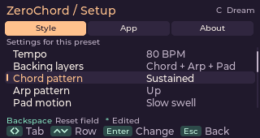

# Presets and customization

A style preset stores the enabled backing layers, independent Front, Chord/Arp, and Pad
sounds, their independent envelopes, all three patterns, and BPM. The selected chord and currently pressed
keys are performance state. Startup is silent.

**App** settings include Theme, **Volume & effects** (Master, Backing and Front
volume, Echo and Low/Mid/High EQ), Hold, Chord config (Key, absolute roots,
shared/per-degree octaves, combinations and recognition timing),
and front-note modes, scale, mappings, actual octaves, K/L actions and strum times. They keep
their values when selecting, saving, or restoring a style preset. Existing app
values are preserved when upgrading. Preset level has been removed.

Output level is `master volume × backing/front volume`. Combined backing layers
receive an additional 1/√(enabled layers) balance; Front stays independent. Master volume scales
both the direct sound and echo.

The app-wide three-band EQ shapes the entire Front, Chord, Arp and Pad mix including
echo, before Master volume and the output clamp. Each band ranges from −12 to
+12 dB in 1 dB steps, initially 0 dB (exact bypass). Low is a 250 Hz shelf,
Mid is a broad 1 kHz peak (Q ≈ 0.707), High is a 4 kHz shelf, using
[RBJ biquad formulas](https://www.w3.org/TR/audio-eq-cookbook/).
Opening the picker auditions the band. Enter applies the choice, Esc cancels,
and Backspace selects 0 dB. EQ survives preset switching and restoration. Existing settings
load flat; saved EQ values live only in the app settings, never preset TOML.

## On the instrument

- **9 / 0:** previous / next preset, including its BPM and remembered edits.
- **Tab** opens settings. **←/→** switches Style, App, and About. **↑/↓**
  selects a row. Style starts with Preset and Tempo. App starts with Theme
  and Volume & effects. Style and App each remember their selected row.
- **Enter** opens the selected page or picker. In a picker, Enter applies
  the choice and Esc cancels. Sound, pattern, key, and mapping choices can
  be auditioned before applying. In Backing layers, select **Apply** to
  confirm all checkboxes together. Pattern auditions run for up to eight
  seconds. Space stops them.
- **Backspace:** restore the highlighted musical setting to the selected preset's
  default. In an open choice list, Backspace highlights the default; Enter still
  confirms it. App fields restore their app defaults: Dark, 100% master, 80% backing, 100% front, 15% echo, flat EQ, 210 ms front strums, 30 ms combination window, C major, Hold On,
  and minichord chord mappings with inherited per-degree overrides.
- **Save as new preset:** confirm to create User001, User002, etc. Its current
  musical settings become its defaults. Rename it by editing its TOML `name`.
- **Restore preset:** confirmation resets every musical setting in the active
  preset. Other presets and app-wide controls are preserved.

A `*` by the preset name means its musical settings differ from its defaults.
A `*` beside a setting marks an edited field; choice lists label the default.
App markers compare against app defaults. Changes are remembered
per preset and written on clean exit. Save as new preset also writes immediately.
A forced kill/power loss can lose edits since the last clean save.

Chord mappings retain **1 = All, 2–8 = II–VII, I**. Backspace restores just the
highlighted mapping at that scope to the app default. Follow All removes a
per-degree override. The Chord config restore action resets root/key, octave, and all four mappings
for that scope, with confirmation; All also resets recognition timing and degree overrides. Mappings are shared across all presets.




## Sound and envelope order

Style rows are Preset, Tempo, Backing layers, Chord pattern, Arp pattern, Pad motion,
Front sound and envelope, Chord/Arp sound and envelope, Pad sound and envelope,
Save as new preset, and Restore preset.

Each envelope editor has Front, Chord/Arp and Pad tabs and Attack, Decay, Sustain,
Release, and Restore envelope rows. Enter opens an auditioning choice list;
Enter applies the choice and Esc cancels. Attack, Decay and Release use milliseconds
(0–5000). Sustain is 0–100%. **Use sound's envelope** preserves the sound's original
decay and sustain. Chord/Arp bound slow attacks and long releases for clarity;
explicit envelope values override those bounds. A one-shot sample
still ends when its recorded audio runs out; Sustain cannot make it loop.
Backspace restores one control to the current preset's default. Restore envelope
resets only that part; Restore preset resets only the current preset.

Custom preset TOML accepts optional `front_attack_ms`, `front_decay_ms`,
`front_sustain_percent`, `front_release_ms`, with equivalent `chord_` and `pad_`
keys. Omitted controls (or -1) use the sound's envelope. Echo is a separate setting.

## Chord roots and front scale

App → Chord config starts each scope with **Octave**. All's next row is **Key**;
a degree's next row is **Root**, with C–B absolute note choices and **Follow Key**.
Default chord roots use major-scale degrees. Custom roots remain fixed when Key
changes. Default octave is 3; each degree can use an absolute octave or Follow All.
These settings remain App-wide across preset changes and restores.

App → Front notes → All shows **Scale** immediately after Front mode when
Scale notes is selected. Major/natural minor affects only front Scale notes.
The tonic comes from Chord config → All → Key. Front/Backing volume defaults
are 100%/80%; saved user volume values are retained on upgrade.

## Backing layers

**O** and **Style → Backing layers** open the same checkbox popup. ↑/↓ (F/X)
selects a row in Chord, Arp, Pad order. Enter toggles the selected layer. **Apply** commits the
whole selection; Esc cancels. Backspace/R selects the preset default without
committing. With no checkboxes selected, **Front only** selects harmony silently
for Z–M/K/L. Hold still controls whether the harmony remains selected.

**Chord** uses the shared Chord/Arp sound and envelope. Manual hit strikes once per chord selection;
Sustained holds the chord without retriggering. Every beat, Every eighth,
Offbeat and Syncopated trigger simultaneous chord notes. Bass/chord 3/4 plays
low bass then two upper chord hits; Bossa accompaniment alternates low root/fifth
under syncopated upper chords. Bass events are voiced an octave lower.

**Arp** uses the shared Chord/Arp sound and envelope and has its own pattern clock.
Up, Down, Up/down, Root and upper notes and Broken eighths use flowing 95% gates.
Up/down repeats its endpoint notes at each turnaround to make a regular
four-beat phrase. Syncopated notes deliberately includes rests. Legacy mixed
Rock/Waltz/Bossa patterns retain their IDs and remain visible when selected in
an older saved setup. New presets use the dedicated Chord equivalents.
These are original accompaniment patterns, with no drums or Omnichord rhythm data.

**Pad** sustains its own sound and envelope. Steady, Slow swell (four 4/4 bars),
Breathe (two beats), and Pulse (one beat) affect only the Pad layer's volume.

Layers share harmony and tempo. Backing gain is balanced by 1/√(enabled layers)
to leave mixing headroom; Front volume and timbre stay independent. Chord/Arp
preserve native sample decay/sustain instead of forcing every sound into the
same short envelope. Their attack is bounded to 10 ms and release to 200 ms
(250 ms for Sustained); explicit envelope settings override these bounds.

Chord changes retain the running phase. Tempo edits change the clock rate
without restarting it. Chord and Arp pattern changes each apply at their current
pattern boundary. Applying a new layer selection or preset starts a new phrase.
Settings entry stops performance; auditions use a temporary setup. Space stops
all layers and queued front strums while preserving settings.

## Factory starting points

Dream remains first. Presets use the current licensed bank, with no automatic
Lo-fi/Hi-fi labels or claimed sample upgrades. An optional, separately licensed Grand Piano
(FluidR3) pack is described in the [sound pack guide](../sounds/README.md).

| Preset | Front | Chord / Arp | Pad | Initial backing | BPM |
| --- | --- | --- | --- | --- | --- |
| Dream | Music Box | Airy Pad | Warm Pad | Chord + Arp + Pad / Sustained + Up + Slow swell | 80 |
| Harp | Harp | Nylon Guitar | Strings | Pad / Steady | 96 |
| Keys | Piano | Piano | Warm Pad | Chord / Sustained | 100 |
| Organ | Organ | Organ | Warm Pad | Chord / Sustained | 100 |
| Pop | Steel-string Guitar | Electric Piano | Warm Pad | Arp / Broken eighths | 112 |
| R&B | Electric Piano | Electric Piano | Warm Pad | Chord / Syncopated | 82 |
| Rock | Overdriven Guitar | Clean Electric Guitar | Organ | Chord / Every eighth | 120 |
| Waltz | Celesta | Piano | Strings | Chord / Bass/chord 3/4 | 96 |
| Bossa | Vibraphone | Nylon Guitar | Warm Pad | Chord / Bossa accompaniment | 128 |

Harp and Dream also default to Sustained for their Chord pattern, including
when the Chord layer is initially disabled. Manual hit remains selectable.

The sound picker shows the source sample rate under the highlighted sound;
mixed-rate instruments show the range and “mixed”. These are rates from the
loaded SoundFont, including imported packs, not the 48 kHz output rate or a
quality score.

Acoustic and bell Front sounds retain native attack/decay/sustain; release is
180 ms, or 320 ms for Dream, Waltz and Bossa. Organ Front uses 5/100/85%/90
ADSR. Chord usually uses a 5 ms attack, native decay/sustain and 100 ms release;
Dream uses 8/400/35%/200, Organ 5/100/85%/100, Rock 3/160/45%/65.
Warm Pad uses 300/800/75%/550; Strings 150/600/75%/400; Organ Pad
80/300/75%/250. Times are milliseconds. These are editable musical starting
points; recordings that do not loop still end naturally.

Unmodified older factory defaults and working copies upgrade to these starting
points. Customized factory files and working copies keep their values. Restore
preset resets only the current preset to its loaded default.

## Editable TOML files

The app uses `$XDG_CONFIG_HOME/zerochord/`, falling back to
`~/.config/zerochord/`. On the first normal launch it exports readable defaults:

```
zerochord/
  presets/factory/harp.toml     # Harp, Dream, Keys, Organ, Pop, R&B, Rock, Waltz, Bossa
  presets/user/user-001.toml    # Your saved/copied presets
  working/dream.toml           # Remembered edits; defaults remain separate
  session.toml                # Selected stable preset ID
  settings.conf               # App controls and legacy-compatible state
```

Close ZeroChord before editing files. It reloads them on next launch. Editing a
factory TOML changes that preset's defaults; existing working edits are retained
until you restore the preset/field. To add a preset, copy a complete factory file
into `presets/user/`, give it a unique lowercase `id` and a display `name`, and
restart. Save-as produces complete examples automatically. These files are data;
the app does not execute them.

Example fields from a complete preset:

```toml
schema_version = 2
id = 'my-pop'
name = 'My Pop'
mode = 'Arp'                    # Also: 'Chord + Pad', 'Chord + Arp', 'Pad + Arp', 'Chord + Pad + Arp', 'Front only'
bpm = 112
backing_sound = 4               # Chord/Arp; GM programs are ZERO-based: 0–127
pad_sound = 89                  # Independent Pad timbre
foreground_sound = 46
chord_pattern = 'quarter'
arp_pattern = 'pop'
pad_motion = 'steady'
```

Preset files keep their existing `mode` spellings for compatibility. The menus
show backing combinations in Chord, Arp, Pad order. Chord/Arp sound and Pad sound
have independent defaults and remembered edits. Older presets without `pad_sound`
start with their previous `backing_sound` for both, preserving their sound.

BPM ranges from 40 to 240. App values live in `settings.conf`, including volumes,
echo (0–60%), front modes/mappings and strum times (60–600 ms), key/scale, Hold,
and combinations with their recognition window (0–60 ms). Legacy
preset volume, level, echo, and sweep fields are accepted but ignored.
Version 1 preset files remain readable, but their former app fields no longer
change the keyboard or key when selecting/restoring a preset. Newly saved
version 2 presets contain only style fields.

Pattern IDs:

| Part | IDs |
| --- | --- |
| Arp | `up`, `down`, `up_down`, `alternating`, `pop`, `rnb`, `rock`, `waltz`, `bossa` |
| Chord | `manual`, `quarter`, `offbeat`, `syncopated`, `waltz`, `sustained`, `eighth`, `bossa` |
| Pad | `steady`, `swell`, `breathe`, `pulse` |

Presets select these built-in patterns; editing arbitrary rhythmic steps is
not implemented. Sparse user files use the base Harp defaults for omitted fields,
so copying a complete exported file is the clearest way to start. Working files
are complete snapshots; subsequent changes to factory files do not replace their
remembered settings automatically.

The loader rejects invalid IDs/ranges/types/pattern names, unknown fields,
unsupported versions, duplicate IDs, and files over 128 KiB; malformed presets
are skipped with a diagnostic. There is a limit of 128 presets. A bad factory
file falls back to its compiled defaults. `--no-save` reads existing settings but
creates no config files, including when testing save-as.

Existing style settings migrate into the active preset's working copy;
key/scale, Hold, and mappings remain app-wide in settings.conf. Subsequent launches
use stable preset IDs, so adding user files does not shift the selected preset.

## Imported sounds

The normal picker contains fourteen named sounds in category tabs. Keys includes
Piano, Electric Piano, Organ, Vibraphone, and Celesta. Plucked includes Harp,
Nylon Guitar, Steel-string Guitar, Clean Electric Guitar, Overdriven Guitar,
and Music Box. Strings contains Strings; Pads contains Warm Pad and Airy Pad.
All use the existing runtime SoundFont bank; no additional bank is bundled. Older program
numbers retain their sound; their embedded SoundFont name appears in a Saved
group when needed. Imported sounds can be used independently for each part.
Optional `pad_sound_id`, `backing_sound_id`, and `foreground_sound_id` strings
identify a sound as `pack-folder/sound-id`. Existing numeric sound fields retain
the built-in fallback. Missing packs keep the ID and play that fallback.
See [pack setup](../sounds/README.md) and [front mappings](FRONT_NOTES.md).

### Tempo and defaults

Dream is first in the preset list and is selected on a fresh launch. Its chord
sound is Airy Pad; Pad and Front keep their separate sounds. Existing sessions
remember their last preset. Stock Dream defaults upgrade without changing
customized presets.

P and Style → Tempo open the same numeric editor. Type 40–240, then Enter to
save or Esc to cancel. Backspace deletes digits; R selects the preset default
for confirmation. Restore preset resets only the current preset; other presets'
remembered edits and all App settings remain intact. Tabs share one appearance,
and navigation hints use arrow symbols throughout.
