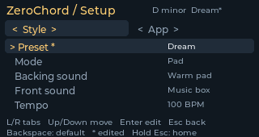

# Presets and customization

A style preset stores the playback mode, independent Pad, Chord/Arp, and Front
sounds, their independent envelopes, all three patterns, and BPM. The selected chord and currently pressed
keys are performance state. Startup is silent.

**App** settings are Theme, Master volume, Backing volume, Front volume, Echo, Low/Mid/High EQ,
Hold, Chord config (Key, absolute roots, shared/per-degree octaves, combinations and recognition timing),
and front-note modes, scale, mappings, actual octaves, K/L actions and strum times. They keep
their values when selecting, saving, or restoring a style preset. Existing app
values are preserved when upgrading. Preset level has been removed.

Output level is `master volume × backing/front volume`. Master volume scales
both the direct sound and echo.

The app-wide three-band EQ shapes the entire Front/Chord/Pad mix including
echo, before Master volume and the output clamp. Each band ranges from −12 to
+12 dB in 1 dB steps, initially 0 dB (exact bypass). Low is a 250 Hz shelf,
Mid is a broad 1 kHz peak (Q ≈ 0.707), High is a 4 kHz shelf, using
[RBJ biquad formulas](https://www.w3.org/TR/audio-eq-cookbook/).
Enter auditions, Enter saves, Esc cancels, and Backspace restores the selected
band to 0 dB. EQ survives preset switching and restoration. Existing settings
load flat; saved EQ values live only in the app settings, never preset TOML.

## On the instrument

- **9 / 0:** previous / next preset, including its BPM and remembered edits.
- **Tab:** opens settings. **←/→** switches **Style / App** tabs;
  **↑/↓** selects a row. Preset is first on Style, followed directly by Tempo. Theme is first on App. Each tab remembers
  its selected row. Values only change through Enter editors (or Backspace reset).
- **Enter:** open a choice list; Enter commits and Esc cancels. Sound, pattern,
  mode, key, and mapping choices audition without committing. Pattern auditions
  run for up to eight seconds; Space stops them.
- **Backspace:** restore the highlighted musical setting to the selected preset's
  default. In an open choice list, Backspace highlights the default; Enter still
  confirms it. App fields restore their app defaults: Dark, 100% master, 80% backing, 100% front, 15% echo, flat EQ, 210 ms front strums, 30 ms combination window, C major, Hold On,
  and minichord chord mappings with inherited per-degree overrides.
- **Save as new preset:** confirm to create User001, User002, etc. Its current
  musical settings become its defaults. Rename it by editing its TOML `name`.
- **Restore preset:** confirmation resets every musical setting in the active
  preset. Other presets and app-wide controls are preserved.

A `*` by the preset name means its musical settings differ from its defaults.
A `*` beside a setting marks an edited field; choice lists label the default.
App markers compare against app defaults. Changes are remembered
per preset and written on clean exit. Save as new preset also writes immediately.
A forced kill/power loss can lose edits since the last clean save.

Chord mappings retain **1 = All, 2–8 = II–VII, I**. Backspace restores just the
highlighted mapping at that scope to the app default. Follow All removes a
per-degree override. The Chord config restore action resets root/key, octave, and all four mappings
for that scope, with confirmation; All also resets recognition timing and degree overrides. Mappings are shared across all presets.




## Sound and envelope order

Style rows are Preset, Tempo, Mode, Arp pattern, Chord pattern, Pad motion,
Front sound / Front envelope, Chord sound / Chord envelope, Pad sound / Pad
envelope, Save as new preset, and Restore preset. Arp uses the Chord sound/envelope.

Each envelope editor uses Front / Chord / Pad tabs and Attack, Decay, Sustain,
Release, and Restore envelope rows. Enter opens an auditioning choice list;
Enter saves and Esc cancels. Attack, Decay and Release use milliseconds
(0–5000); Sustain is 0–100%. **Sound default** preserves the sound's original
behavior, including the clear rhythmic chord articulation. A one-shot sample
still ends when its recorded audio runs out; Sustain cannot make it loop.
Backspace restores one control to the current preset's default. Restore envelope
resets only that part; Restore preset resets only the current preset.

Custom preset TOML accepts optional `front_attack_ms`, `front_decay_ms`,
`front_sustain_percent`, `front_release_ms`, with equivalent `chord_` and `pad_`
keys. Omitted controls (or -1) use Sound default. Echo is unchanged and separate.

## Chord roots and front scale

App → Chord config starts each scope with **Octave**. All's next row is **Key**;
a degree's next row is **Root**, with C–B absolute note choices and **Follow Key**.
Default chord roots use major-scale degrees. Custom roots remain fixed when Key
changes. Default octave is 3; each degree can use an absolute octave or Follow All.
These settings remain App-wide across preset changes and restores.

App → Front notes → All shows **Scale** immediately after Front mode when
Scale notes is selected. Major/natural minor affects only front Scale notes.
The tonic comes from Chord config → All → Key. Front/Backing volume defaults
are 100%/80%; saved user volume values are retained on upgrade.

## Playback modes

**Front only** selects the chord without starting backing notes. Z–M and K/L
play the selected harmony. Hold determines whether it stays selected after release.

**Pad** sustains the backing sound. Motion choices are Steady, Slow swell (four
bars), Breathe (two beats), and Pulse (one beat). Motion changes backing volume;
foreground Z–M and K/L retain their own sound and articulation.

**Chord** plays all four chord notes simultaneously with a quick attack and
falling envelope. Manual hit plays once per chord-button press. Sustained starts
all notes together with a quick attack, then holds their level: Hold Off stops
the chord on release, Hold On keeps it until the next chord or Space. It uses
Chord sound and Chord envelope; custom ADSR values override the default clear
attack and 65% held level. One-shot samples still end with their recording.
The saved pattern ID is `sustained`; older pattern IDs retain their meanings.
Every beat,
Offbeat, Syncopated, and Waltz add repeating accompaniment. Hold retains the
harmony; it does not repeat Manual hit.

**Arp** plays rhythmic chord-tone patterns. Choices are Up, Down, Up/down,
Alternating bass, Pop, R&B, Rock, Waltz, and Bossa. Some style patterns include
upper-note groups alongside individual bass notes. These are original simple
accompaniments inspired by the style concept, without sampled drums or borrowed
Omnichord rhythm data. Waltz has three beats per bar; the other patterns use four.

**O** cycles Pad → Chord → Arp → Front only and immediately applies the selected mode to the
current chord. **Z–M** play foreground notes. **K/L** strums them or shifts their
octave, as configured separately for Chord notes and Scale notes in
[Front notes](FRONT_NOTES.md). Backing Chord hits are simultaneous and do not use
the front strum time. **Space** stops playback and preserves all musical settings.

Chord changes retain the running rhythmic phase. Entering tempo changes the clock's
rate without restarting it. Pattern changes during playback take effect at the
next boundary of the current pattern; mode/preset changes start a new phrase.
Settings entry stops performance; its auditions use a separate temporary setup.

## Editable TOML files

The app uses `$XDG_CONFIG_HOME/zerochord/`, falling back to
`~/.config/zerochord/`. On the first normal launch it exports readable defaults:

```
zerochord/
  presets/factory/harp.toml     # Harp, Dream, Keys, Organ, Pop, R&B, Rock, Waltz, Bossa
  presets/user/user-001.toml    # Your saved/copied presets
  working/dream.toml           # Remembered edits; defaults remain separate
  session.toml                # Selected stable preset ID
  settings.conf               # App controls and legacy-compatible state
```

Close ZeroChord before editing files. It reloads them on next launch. Editing a
factory TOML changes that preset's defaults; existing working edits are retained
until you restore the preset/field. To add a preset, copy a complete factory file
into `presets/user/`, give it a unique lowercase `id` and a display `name`, and
restart. Save-as produces complete examples automatically. These files are data;
the app does not execute them.

Example fields from a complete preset:

```toml
schema_version = 2
id = 'my-pop'
name = 'My Pop'
mode = 'Arp'                    # Pad, Chord, Arp, or Front only
bpm = 112
backing_sound = 4               # Chord/Arp; GM programs are ZERO-based: 0–127
pad_sound = 89                  # Independent Pad timbre
foreground_sound = 46
arp_pattern = 'pop'
chord_pattern = 'quarter'
pad_motion = 'steady'
```

Pad sound and Chord sound have independent defaults and remembered edits.
Arp uses Chord sound; Z–M/K/L use Front sound. Older presets without `pad_sound`
start with their previous `backing_sound` for both, preserving their sound.

BPM ranges from 40 to 240. App values live in `settings.conf`, including volumes,
echo (0–60%), front modes/mappings and strum times (60–600 ms), key/scale, Hold,
and combinations with their recognition window (0–60 ms). Legacy
preset volume, level, echo, and sweep fields are accepted but ignored.
Version 1 preset files remain readable, but their former app fields no longer
change the keyboard or key when selecting/restoring a preset. Newly saved
version 2 presets contain only style fields.

Pattern IDs:

| Part | IDs |
| --- | --- |
| Arp | `up`, `down`, `up_down`, `alternating`, `pop`, `rnb`, `rock`, `waltz`, `bossa` |
| Chord | `manual`, `quarter`, `offbeat`, `syncopated`, `waltz` |
| Pad | `steady`, `swell`, `breathe`, `pulse` |

Presets select these built-in patterns; editing arbitrary rhythmic steps is
not implemented. Sparse user files use the base Harp defaults for omitted fields,
so copying a complete exported file is the clearest way to start. Working files
are complete snapshots; subsequent changes to factory files do not replace their
remembered settings automatically.

The loader rejects invalid IDs/ranges/types/pattern names, unknown fields,
unsupported versions, duplicate IDs, and files over 128 KiB; malformed presets
are skipped with a diagnostic. There is a limit of 128 presets. A bad factory
file falls back to its compiled defaults. `--no-save` reads existing settings but
creates no config files, including when testing save-as.

Existing style settings migrate into the active preset's working copy;
key/scale, Hold, and mappings remain app-wide in settings.conf. Subsequent launches
use stable preset IDs, so adding user files does not shift the selected preset.

## Imported sounds

The normal picker contains ten named sounds in category tabs. Older program
numbers retain their sound; their embedded SoundFont name appears in a Saved
group when needed. Imported sounds can be used independently for each part.
Optional `pad_sound_id`, `backing_sound_id`, and `foreground_sound_id` strings
identify a sound as `pack-folder/sound-id`. Existing numeric sound fields retain
the built-in fallback. Missing packs keep the ID and play that fallback.
See [pack setup](../sounds/README.md) and [front mappings](FRONT_NOTES.md).

### Tempo and defaults

Dream is first in the preset list and is selected on a fresh launch. Its chord
sound is Airy Pad; Pad and Front keep their separate sounds. Existing sessions
remember their last preset. Stock Dream defaults upgrade without changing
customized presets.

P and Style → Tempo open the same numeric editor. Type 40–240, then Enter to
save or Esc to cancel. Backspace deletes digits; R selects the preset default
for confirmation. Restore preset resets only the current preset; other presets'
remembered edits and all App settings remain intact. Tabs share one appearance,
and navigation hints use arrow symbols throughout.
