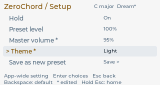
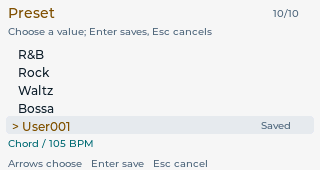
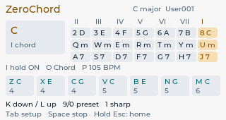
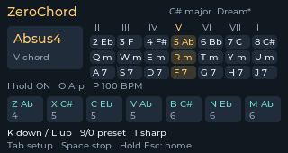
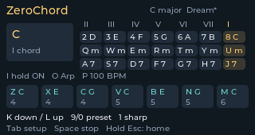
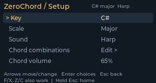
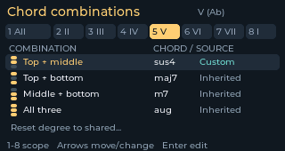
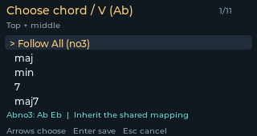

# Testing ZeroChord

## 1.1.0 backing layers and preset tuning

All six local suites pass, including all eight layer combinations, checkbox
apply/cancel/default, app and preset round-trips, current-preset restore,
independent Front/Chord/Arp/Pad rendering, Pad-only motion, panic and normal-level
clipping checks. The real app passes 20 isolated keyboard/save/restart flows,
including O and Style checkbox paths using printed F/X arrows, none/all
selections and cancellation. The 320×170 popup and multi-layer status are
visually checked locally. Cross-compilation runs on the development Mac.
Device validation for this iteration is one preview deployment/launch, with no
repeated device suite. Musical feel and speaker tone still need listening.

Earlier sections below record previous iterations; their run counts describe
those versions. Hardware scripts have updated controls but have not been rerun
as part of this change.

## Global EQ and sustained chord pattern

All six desktop suites and all six ASan/UBSan suites pass locally (macOS leak
sanitizer disabled). Tone tests at 44.1/48 kHz measure the Low/Mid/High bands at
−12, −6, 0, +6 and +12 dB, neutral bypass and stereo independence. Real SoundFont
rendering verifies EQ processes the full dry/echo mix, Master mute still works,
and panic clears filter tails. Sustained Chord tests cover a prompt attack,
audible held body after two seconds, release with Hold Off, latch with Hold On,
chord replacement, panic, and preset pattern round-trip. Existing pattern IDs
and defaults are retained; EQ survives style changes, restore and reload.

The real app passes 15 isolated save/restart flows using printed F/X/Z/C keys,
including EQ edit/cancel/restore and choosing Sustained. Dark/light EQ layouts
are inspected at 320×170. Only the local ARM cross-build and one deployment/launch
check follow these local checks; no second full test suite runs on the device.
Speaker bass response and preferred EQ amounts remain listening judgments.

## Menu navigation audit — 2026-11-21

Physical printed arrows F/X/Z/C and dedicated arrow events now use the same
navigation in every settings page and picker. Previously the Front notes and
Chord combinations pages accepted only dedicated arrow events, leaving the
device's printed arrows unresponsive. Local coverage walks all Style/App rows,
both front modes and every key tab, and every chord scope, including wraparound,
sound categories, preview isolation, Enter commit, Esc cancel, Backspace default,
and Tab closing a pending edit. The main view separates each note plus octave
from its keyboard label, checked locally at 320×170 in dark and light themes.

## Front editor and combination recognition — 2026-11-21

The local regression checks cover arrow-only front tabs, All/per-key restores,
actual-octave migration, default layout preservation, chord/scale modes, per-mode
K/L actions/times, octave bounds, and settings persistence across style changes.
Combination recognition covers all row-button orders, a fixed first-press
deadline, staggered three-button presses, late additions, immediate front notes,
release stability, cancellation, and preserved rhythmic phase. The 30 ms trial
default is adjustable; no hardware action-to-sound latency has been measured.

## macOS cross-build — 2026-11-21

The device app now builds locally with project-local Zig 0.15.2, targeting Linux
ARM64 with glibc 2.36 compatibility. The first full build, including the compiler
download, took 41.3 seconds on the development Mac. The produced ELF was copied
to the CardputerZero with checksum verification and launched successfully with
the framebuffer and normal audio enabled. No compilation or repeated test suites
ran on the device. The previous native binary is retained for rollback.

## Named sounds, packs, and front notes — 2026-11-21

Local coverage adds curated/category picker transactions, manifest validation,
real SF2 pad/chord/front routing, missing-pack fallback, stable IDs and preset
round trips, front-key editors/reset/cancel/persistence, chord-aware versus fixed
intervals, actual octaves, separate chord/scale layouts, and matching pluck/strum pitches. Five local
suites pass. Both new editors are checked at 320×170 before one local ARM64 cross-build.
A successful device audio launch is checked; the local suites are not rerun there.

## App controls and menu order — 2026-11-21

Volume, echo, and sweep are app-wide; preset level is removed. Style starts
with Preset then Tempo; App starts with Theme. All four local suites pass,
including app defaults, preservation across preset selection/restore/restart,
legacy preset compatibility, and master scaling of dry and wet audio. The
local 320×170 layout is checked before one native app build and launch; no
repeat device test suite or package rebuild is needed for this iteration.

## Separate sounds and Front only — 2026-11-21

Pad sound and Chord sound are separate preset fields; Arp uses Chord sound.
Older presets inherit their former backing sound for Pad. Local checks cover
independent audio routing with the real SoundFont, foreground independence,
per-field reset, preset round-trip, and legacy fallback. Front only tests verify
silent chord selection, retained harmony, foreground notes/sweeps, mode cycling,
and persistence. All four local suites passed before the device build. The
updated native app was reopened; repeated device test suites and packaging
were skipped for this iteration. The previous packaged release remains unchanged.


## Tabbed settings update — 2026-11-21

Settings now have Style and App tabs. Left/Right switches tabs without changing
values; Up/Down selects rows and Enter opens a transactional editor. Each tab
remembers its row. Preset is first on Style. Hold retains its existing name.

App-wide key/scale, Hold, chord combinations, master volume, and theme survive
preset selection, save-as, restoration, and restart. Style presets retain BPM,
sounds, patterns, levels, echo, and sweep timing. Version 1 files remain readable;
new version 2 preset files omit app fields. Tests cover the upgrade with a legacy
working snapshot whose app values differ from the active settings.

The four desktop and native suites passed. Both tabs were visually checked at
320×170. A focused real-evdev check passed for tab switching, Enter/cancel, tempo
editing, preset recall, global settings persistence, restart, and framebuffer
capture. The broad device audio integration suite was not repeated for this UI
change. The updated preview was reopened with the user’s setup preserved.


## Desktop first, hardware early

The [official CardputerZero template](https://github.com/CardputerZero/Template)
provides an SDL simulator for fast UI development and a separate Linux device
build. That supports a two-stage workflow; it does not establish that simulation
can validate keyboard rollover, speaker quality, or end-to-end audio latency.

ZeroChord separates its music state machine and offline audio renderer from
LVGL and physical devices. Use all three layers below.

### 1. Deterministic local tests

```sh
.venv/bin/ctest --test-dir build/desktop --output-on-failure
```

`musical_behavior` exercises 12 keys, major/natural minor roots, all combination
qualities, press/release stability, sharp, slash bass, repeat suppression,
momentary/held chords, sweep pitches/direction/timing, phase-preserving rhythm scheduling, simultaneous chord hits, all patterns, preset
changes/revoicing, bounded stall recovery, and panic cancelling queued sweeps.

`audio_rendering` uses the real sound bank: the four original sound pairs and nine complete factory presets must produce finite,
nonzero samples without clipping in the test sequence. It checks independent
releases of identical pitches, immediate panic silence, and a held chord surviving
100 harp triggers. It also plays all ten assignable chord qualities with their
seven harp notes through all four presets. These tests do not prove every possible performance is free
of clipping.

`settings_behavior` tests minichord defaults, no3/sus voicings, shared and
per-degree mappings, all scope shortcuts, inherited/custom behavior, preview
transactions, Enter/Esc, sound choices, reset confirmation, real performance
dispatch, persistence, legacy configurations, and invalid-value recovery.

`preset_behavior` tests complete TOML round-trips, file validation, legacy migration,
per-preset working copies and stable selection, all musical defaults, individual
Backspace reset and picker cancel, app-wide volume/theme preservation, save-as,
edited factory defaults, and no-save behavior.

Audio regressions additionally verify prompt chord attacks, finite gates,
flowing arp continuity, master gain on direct sound and echo, and Pad motion
preserving Front, Chord and Arp. Panic must discard previous voices before the next note unmutes output.

AddressSanitizer and UndefinedBehaviorSanitizer can be enabled on the standalone
engine build:

```sh
.venv/bin/cmake -S . -B build/sanitize -DZEROCHORD_GUI=OFF \
  -DCMAKE_BUILD_TYPE=Debug \
  -DCMAKE_CXX_FLAGS='-fsanitize=address,undefined -fno-omit-frame-pointer' \
  -DCMAKE_EXE_LINKER_FLAGS='-fsanitize=address,undefined'
.venv/bin/cmake --build build/sanitize -j4
.venv/bin/ctest --test-dir build/sanitize --output-on-failure
```

### 2. Desktop UI and rendered sound

Run the SDL app to inspect the same 320 x 170 LVGL screen at 3x size. This is a
desktop preview, not a CPU or hardware emulator. Test scripts enter musical keys
through the app's normal input dispatcher. Native-resolution screenshots use PPM:

```sh
build/desktop/M5CardputerZero-ZeroChord --headless --no-audio --no-save \
  --script tests/performance.events --quit-after-ms 1700 \
  --capture build/performance.ppm
python3 scripts/ppm_to_png.py build/performance.ppm build/performance.png
build/desktop/zerochord-render .tools/soundfonts/TimGM6mb.sf2 build/demo.wav
```

`--no-audio` is explicit: normal launches fail with a diagnostic if audio cannot
start. `--no-save` prevents test settings from overwriting user settings; tests
that need known defaults should also use an isolated `XDG_CONFIG_HOME`.

### 3. Cross-build locally, validate the launch on device

After the relevant desktop checks, run on the Mac:

```sh
.venv/bin/python scripts/build_device.py
sh scripts/deploy_device.sh
```

Zig and its caches stay in `.tools/`; the ARM64 binary and incremental objects
stay in `build/cross-device/`. Deployment uses the existing SSH host and wrapper,
checks the copied binary's SHA256, saves settings by stopping the old preview
cleanly, preserves its binary, and launches the new one. It verifies the service
and child process after two seconds and restores the old binary if startup fails.
The sound bank remains supplied by the device's Debian package. The installed
APPLaunch package is separate from this development preview.

Normal iterations require no on-device compilation or repeated local suites.
Use focused hardware integration only for an observed regression or a specific
physical input, framebuffer, audio backend, or lifecycle risk.

#### Native compilation: diagnostic fallback only

If deliberately investigating a compiler difference on Linux AArch64:

```sh
.tools/cmake/bin/cmake -S . -B build/device -DZEROCHORD_DESKTOP=OFF \
  -DCMAKE_BUILD_TYPE=Release \
  -DZEROCHORD_TEST_SOUNDFONT=/usr/share/sounds/sf2/TimGM6mb.sf2
.tools/cmake/bin/cmake --build build/device --target ZeroChord -j1
```

The device has about 352 MiB usable RAM. Parallel C++ compilation can exhaust
memory and stall SSH; do not use it as the normal development build host.

#### Focused hardware integration

Run `python3 scripts/device_input_test.py` on the device only when that broader
check is justified. It needs the development test fixtures on the device.

The integration test creates a temporary uinput keyboard and passes its event
path only to ZeroChord. It stops the user's `APPLaunch.service` for display
ownership and always restarts it on completion/failure. It exercises real evdev
delivery, framebuffer output, the PipeWire PulseAudio service, combinations,
strums, arp, Space, settings, short/long Esc, and SIGINT. It does not replace the
physical keyboard's by-path symlink. Run only when interrupting the launcher is
acceptable, with no other app playing. User must have access to input/video/audio.

The editor regression uses real evdev arrow/Enter/number events to set shared
no3 and V-only sus4, cancel a candidate change, and return to performance. It also
saves/reloads custom mappings and complete presets in an isolated configuration directory, preserving
the user's own settings. Kernel framebuffer captures include the combination
editor and picker. Fixture scripts accept UP/DOWN/LEFT/RIGHT/ENTER as named keys.

The test also starts the preview with backlight brightness zero, checks that it
wakes, and reads the kernel framebuffer independently of LVGL. It compares this
readback with the rendered performance screen within RGB565 quantization error.
The app's `--capture` alone captures its internal render buffer and cannot prove
that the panel is lit. Even framebuffer readback and backlight state need a
physical visual check to confirm the panel actually displays the expected UI.

To run a development preview over SSH, use `scripts/run_device_preview.sh`
instead of stopping the launcher and invoking the binary directly. It wakes a
sleeping backlight while preserving nonzero brightness, then restores APPLaunch
on exit. The framebuffer backend also requests `FB_BLANK_UNBLANK` on startup.
To recover a failed preview, stop its user service and start the launcher:

```sh
systemctl --user stop zerochord-preview.service
systemctl --user start APPLaunch.service
```

The framebuffer backend honors `LV_LINUX_FBDEV_DEVICE`, otherwise prefers
`st7789`/`panel-mipi` devices and validates 320 x 170 geometry before mapping.
The verified development unit uses `/dev/fb0` (`panel-mipi-dbid`, RGB565); this is
detected rather than hard-coded. `ZEROCHORD_INPUT_DEVICE` overrides the default
keyboard for diagnostics. `SYN_DROPPED`, focus loss, and disconnect cause panic.

## Install and launcher checks

The package installs its desktop entry, wrapper, binary, and icon under
`/usr/share/APPLaunch`. Installation needs root. The current development unit
requires an interactive sudo password; do not put that password in scripts or
chat. Install the prepared package in a device terminal, then restart the user's
launcher service:

```sh
sudo dpkg -i ~/ZeroChord/dist/zerochord_0.1.0_arm64.deb
systemctl --user restart APPLaunch.service
```

Confirm the ZeroChord entry and icon appear, launch it, play a chord and harp,
then hold Esc to return. Also verify the launcher's Home forced-quit behavior.
If a dependency is missing, install `timgm6mb-soundfont` and `libpulse0` using the
device's normal package manager, then retry. The app does not install them itself.

## Hands-on acceptance

These checks need the actual keyboard and listening; injected events cannot
substitute for them:

- Play 8–5–T–4 while using Z–M, K/L, and presets. Confirm direction and comfort.
- Hold 8+U+J (augmented), then 1+8+U+J; play harp keys simultaneously. Check
  physical rollover/ghosting and that every release arrives.
- Play slash chords and rolled combinations. Judge base-column precedence and
  whether the brief intermediate chords feel acceptable.
- Compare all sounds on speaker and headphones. Adjust balance/echo, play dense
  passages for several minutes, and listen for clipping, clicks, or dropouts.
- Measure input-to-output latency with a loopback/contact recording or an
  oscilloscope if a numeric latency target is needed. Callback count and queue
  overflow metrics alone are not end-to-end latency measurements.
- Exit/relaunch to check saved settings and silent startup. Test short Esc in
  settings, long Esc, Home, and unexpected audio/input disconnection.

## Complete preset update — 2026-11-21

- Four CTest suites pass on desktop Release, desktop ASan/UBSan, and native
  CardputerZero AArch64 Release: musical behavior, settings, complete presets,
  and real SoundFont audio rendering.
- All nine factory styles render audible, finite audio; all rhythm choices
  exercise the actual scheduler. Tests cover simultaneous Chord hits, falling
  amplitude, phase continuity across harmony/tempo changes, bounded stall
  recovery, independent foreground sound, and master × preset gain including echo.
- TOML tests cover full round-trips, schema/range/type/name validation, malformed
  files, stable IDs, legacy migration, custom defaults, remembered edits, field
  and whole-preset restores, globals surviving preset changes, save-as file
  collision avoidance, and no-save behavior.
- Real evdev integration passes shared no3/V-only sus4 editing, picker cancel,
  Backspace field reset, BPM preservation, mode and all part-pattern edits,
  save-as User001, preset switching/recall, complete restore, global master/theme
  preservation, clean exit and reload. Configurations are isolated from the
  user's setup. Native framebuffer captures show both themes and preset choices.
- Independent kernel framebuffer readback matches the internal rendered frame
  within RGB565 quantization error. Backlight wake, short/long Esc, SIGINT, and
  return to APPLaunch pass.
- PulseAudio output capture contains **1,881,600 stereo frames**, peak **8,953 /
  32,768**. Every app run reports **zero audio command-queue overflows**.
  Dream at 100 BPM with echo disabled has peak 10 ms mean-square energy
  **1,416,549.19** in Pad, **0** after the Manual Chord hit has decayed, and
  **0–67,059.03** in Arp. This verifies digital output and timing gaps; it does
  not measure acoustic quality, physical key rollover, or end-to-end latency.







## Earlier prototype evidence

2026-11-21, before complete presets (the earlier middle mode was called Strum):

- Desktop engine and renderer tests passed in Release and with ASan/UBSan.
- The settings/persistence test suite also passed in Release and with ASan/UBSan.
- Actual SDL window launched and exited successfully; main/settings screenshots
  were checked at 320 x 170.
- The real desktop audio callback ran with zero command-queue overflows; saved
  settings were checked across a restart in an isolated configuration directory.
- Native AArch64 Release build succeeded; all three CTest tests passed on device.
- Device integration passed with the physical framebuffer and a temporary evdev
  keyboard: combinations, K/L, arp, Space, settings, short/long Esc, and SIGINT.
  The latest PulseAudio output monitor captured 1,149,600 stereo frames with nonzero
  signal (peak 8,515 / 32,768); each app run reported zero command-queue
  overflows. This verifies signal reached the audio service, not acoustic quality
  or absence of every possible dropout. The launcher was restored and active.
- The performance image below comes from independent kernel framebuffer readback;
  the settings image comes from the native app's internal render buffer. Neither
  image alone verifies physical panel visibility.
- An SSH preview exposed a missed sleeping-backlight case (brightness zero).
  The launcher was restored; preview startup now wakes the backlight, and the
  regression test checks wake behavior and independent kernel framebuffer output.
- The Debian archive was parsed; desktop entry, executable wrapper, stripped
  AArch64 binary, PNG icon, dependencies, and license notices were verified.
- System launcher installation: pending interactive sudo authentication.
- Physical rollover, listening tests, and measured end-to-end latency: pending.
- Customization update: native/desktop/sanitizer suites passed, along with real
  evdev shared no3/V-only sus4 edits, picker cancel, and isolated save/reload.
- Playback update: desktop, native, and ASan/UBSan suites cover the O cycle,
  sustained Pad, a single four-note Strum, timed Arp notes, and manual harp
  sweeps alongside Strum. All four sound presets pass short-note attack and
  quiet-gap regressions. The actual Dream control path verifies sustained Pad,
  Strum falling silent, and three separate Arp pulses with quiet gaps.
- Live Dream output was also measured through the device's PulseAudio sink
  monitor with echo disabled in an isolated test configuration. Ten-millisecond
  windows had peak mean-square energy 1,489,405.73 for Pad, zero for Strum after
  its sweep ended, and 0–185,000.21 for Arp. The recorder requests 50 ms latency;
  measurements allow the output/capture buffers to settle. This verifies the
  electronic output, while speaker/headphone listening remains a hands-on check.











## Rebuild the package

On the device, use the CardputerZero application skill's packaging helper
(`make_applauncher_package.py`) as the staging contract. Copy it into `.tools/`
for this development-only command; it is not part of the installed package:

```sh
python3 scripts/package.py --helper .tools/make_applauncher_package.py
dpkg-deb --info dist/zerochord_0.1.0_arm64.deb
dpkg-deb --contents dist/zerochord_0.1.0_arm64.deb
```

The packaging script uses staging-only helper flags. Neither `--install-local`
nor `--auto-install-cardputer` is passed; package creation does not install system
files or restart the launcher. It rejects non-AArch64 binaries, strips the staged
binary, retains license notices, and produces `dist/zerochord_0.1.0_arm64.deb`.
Requires Python 3.9+, GNU `strip`, and `dpkg-deb` on the packaging host.

### Tempo, tabs and preset isolation (2026-11-21)

The local menu audit covers both dedicated arrows and the physical F/X/Z/C
arrows across Style, App, all front tabs, all chord scopes, and sound groups.
Numeric tempo tests cover shared P/menu entry, save/cancel, deletion, range
validation, preset default, and unchanged audio transport. Preset tests edit two
styles, restore one, and reload to verify the other survives. Dream stock
migration preserves customized defaults and working snapshots. Layouts are
rendered locally at 320×170 for both themes and every tab layout, including
the tempo popup and performance hints. The ARM64 binary is cross-built locally
and deployed once, with only a launch check on the device.

## Envelopes and chord configuration

Local regression coverage checks independent Front/Chord/Pad ADSR routing,
attack and release timing, decay/sustain level, release on StopChord, optional
TOML validation/persistence, and preset-scoped restore. The menu audit walks all
controls with dedicated arrows and physical F/X/Z/C arrows, exercising preview,
save, cancel and default restore. Chord checks cover octave inheritance, absolute
roots staying fixed across key changes, root/scale independence, sharp, MIDI
bounds, settings persistence and preset operations preserving App settings.
Layouts are captured locally at 320×170 before one ARM cross-build and deploy;
no full second test suite is run on the device.

This batch passed all five local suites, and the changed pages were inspected in
both themes at 320×170. The Mac ARM64 cross-build completed in six seconds;
the transferred binary passed the preview service/process launch check.

## Broad physical-key scenario audit

See [the scenario review](SCENARIO_REVIEW.md) for the 80% backing default,
reproduced bugs, physical Z/C/F/X workflows, rendered-audio checks, sanitizer
results, design observations and local reproduction commands.
