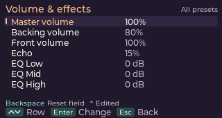

# ZeroChord user guide

ZeroChord turns your CardputerZero keyboard into a chord-and-harp instrument.
Select a chord, then play its individual front notes. The backing and front
parts have separate sounds and envelopes.

## Start playing

Open ZeroChord from APPLaunch. Startup is silent. The initial preset is Dream,
with Chord, Arp and Pad backing layers and a bright front sound in the key of C.
The main screen labels the current **Key** and **Preset** separately.

Press **8**, then play **Z X C V B N M**. Try **8 → 5 → T → 4** for C, G, Am, F.
Press **Space** to stop everything. Hold **Esc** for about a second to exit.
Use a clean exit to save your settings; removing power can lose recent edits.

## Chord buttons

Each column shows its degree and root above the physical keys. Read
**M**, **m**, and **7** at the left for major, minor, and seventh. In the
default key of C:

| Row / degree | II (D) | III (E) | IV (F) | V (G) | VI (A) | VII (B) | I (C) |
| --- | --- | --- | --- | --- | --- | --- | --- |
| Major | 2 | 3 | 4 | 5 | 6 | 7 | 8 |
| Minor | Q | W | E | R | T | Y | U |
| Seventh | A | S | D | F | G | H | J |

Combine buttons **within a column** for more chord qualities:

| Combination | Default |
| --- | --- |
| Top + middle | Diminished |
| Top + bottom | Major seventh |
| Middle + bottom | Minor seventh |
| All three | Augmented |

For example **8 + U** selects C diminished. Press the buttons close together;
the default 30 ms combination window groups them into one attack. Change that
window, or assign no3/sus2/sus4, in **App → Chord config**.
Hold **1** while selecting a chord to raise its root and bass by one semitone.
Releasing **1** leaves that selected chord unchanged; the next chord selection
uses the modifier's current state. The main page shows **+1** while held and the
chord grid shows the roots the next selection will use.
Front Chord notes follow the selected chord; holding **1** raises new front notes
one semitone above those pitches. For example, over C# a new root note becomes D
while 1 is held, and returns to C# for notes played after release.
In Scale mode, **1** sharpens new front notes independently of the backing chord.
Front-note labels match the next notes. Ringing notes and queued K/L strums
retain the pitches they started with.
Hold one column and press another to choose a different bass note.

## Backing modes and Hold

Press **O**, or open **Style → Backing layers**, for the same checkbox popup.
Use **↑/↓** (printed **F/X**) to select Chord, Arp or Pad, then **Enter** to
toggle it. Select **Apply** and press Enter to save all changes together.
**Esc** cancels; **Backspace** or **R** selects the preset defaults for confirmation.
Select none for Front only; select several to layer them. The selected harmony
stays latched when applying layers. Their patterns are set separately in Style.

| Mode | What the chord buttons do |
| --- | --- |
| Chord | Strike the chord notes together using the shared Chord/Arp sound |
| Arp | Repeat chord tones in the selected rhythmic pattern |
| Pad | Play a soft continuous chord, with optional volume motion |
| Front only | Select harmony silently, ready for Z–M and K/L |

In Chord mode, **Manual hit** plays once, **Sustained** keeps the sound going,
and Every beat, Every eighth, Offbeat, Syncopated, Bass/chord 3/4 and Bossa
accompaniment repeat it rhythmically. Bass events play an octave below the chord.
Arp choices are Up, Down, Up/down, Root and upper notes, Broken eighths and
Syncopated notes. Previously saved mixed patterns remain playable. They do not
add a drum track. Multiple backing layers share tempo and harmony; Pad motion
changes only Pad. The mixer balances combined backing layers to leave headroom.

**I** toggles **Hold**. On keeps the selected harmony after releasing its buttons.
Off stops backing when the chord buttons are released. Hold does not repeat
a Manual hit. Space stops the backing, front notes and queued strums.

## Front notes and K/L

**Z–M** runs from lower to higher notes. The screen puts the note and octave
above its keyboard label. **App → Front notes** has two modes:

- **Chord notes:** front notes follow the selected chord and its quality.
- **Scale notes:** seven notes follow the selected key and major/natural minor
  scale; they can play without selecting a chord first.

On All, choose the mode and K/L action. **Strum** sweeps M→Z with K and Z→M
with L; Strum time is the time for the complete sweep. **Octave shift** moves
front notes down with K and up with L. Each mode remembers its own action.
Move to a key tab to change its note and absolute octave. See
[front customization](FRONT_NOTES.md) for details.

## Settings without guesswork

Press **Tab**. **Z/C** switches tabs and **F/X** moves the selection, matching
the printed ←/→ and ↑/↓ arrows. Dedicated arrow events work too. At the
bottom of each menu, keycaps sit beside the actions for the current selection.

Press **Enter** to open the highlighted page or picker. In a picker, use ↑/↓
to choose a value, Enter to apply it, and Esc to cancel. **Current** marks the
active value. **Default** marks the value Backspace selects. Sound pickers use
←/→ to switch groups. On a settings page, Esc goes back. Hold Esc to exit.

Open **Style → Tempo** or press **P** while playing. Type a tempo from 40 to
240 BPM and press Enter. **R** loads the preset tempo for you to apply.

The caption under the active tab tells you what an edit affects.
**Settings for this preset** appears under Style for Tempo, Backing layers,
patterns, sounds, and envelopes. **Applies to all presets** appears under App
for Theme, Volume & effects, Hold, Front notes, and Chord config.

### Presets and defaults

**9/0** changes presets. Each preset remembers its edited sounds, envelopes,
tempo and patterns. **Backspace** restores one highlighted field to its default;
inside an editor it highlights the default and Enter still confirms.

A **\*** means a setting differs from its default. **Save as new preset** makes
an editable copy. **Restore preset** resets only the current preset, after
confirmation. Other presets and App settings are preserved.

### Volumes, EQ and Echo

Open **App → Volume & effects** for Master, Backing and Front volume, Echo,
and EQ. Esc returns to App. The volume defaults are 100%, 80% and 100%.
Master controls the complete output, including Echo.

**EQ Low/Mid/High** boosts or cuts the complete mix by −12 to +12 dB per band.
Start at 0 dB; try Low +3 dB for more bass, and compare while playing. The small
speaker has limited low-frequency output. Strong boosts can distort; lower
Master volume or reduce the boost if that happens. Backspace resets one band
to 0 dB. EQ is shared across presets.

**Echo** adds a quiet delayed repeat, about 230 ms later. It is separate from
the sound's envelope. Set it to 0% for a dry sound.

### Envelopes

The envelope tabs are Front, Chord/Arp and Pad. Chord and Arp use the same envelope.

| Control | Meaning |
| --- | --- |
| Attack | Time to rise to full level |
| Decay | Time to fall to the held level |
| Sustain | Level while the note is active |
| Release | Fade after the note stops |

**Use sound's envelope** keeps the sound's original decay/sustain, with bounded backing
chord articulation. A recorded one-shot sound cannot continue beyond its sample
just by increasing Sustain. Restore envelope affects only that part.

### Chord configuration

**App → Chord config** starts with All. **1** selects All; **2–8** selects
II–VII/I. ←/→ also switches scope. All has Octave and Key first; a degree has
its own Octave and absolute Root. Follow All/Follow Key removes an override.
Root, octave and combination mappings remain the same when switching presets.
Front Scale notes have their own major/minor setting under Front notes → All.

### About

Tab → **About** (after Style and App) shows the running version, a note that the
user guide and more details are in the repository, and a QR code for the GitHub
source and documentation. The code stays black on white in either theme and works
offline; your phone needs network access to open the page. Esc returns to playing.

## Add your own sounds

Copy named SoundFont packs into `ZeroChord/sounds/` on the TF card, or
`~/ZeroChord/sounds/`, then restart the app. They appear alongside the small
built-in sound set. Front, Chord/Arp and Pad can each choose an imported sound.

See [the sound pack guide](../sounds/README.md) for the manifest and size limits.
Use sound files whose license permits your intended use.
An optional, checksum-verified Grand Piano (FluidR3) pack can be fetched with
`scripts/fetch_piano_pack.py`; it is not part of the installed package.

## Troubleshooting

| Symptom | Try |
| --- | --- |
| Silent on startup | Press 8; startup is deliberately silent |
| Chord button is silent | Check Front only mode, Backing/Master volume, and Hold |
| Chord fades while Hold is On | Choose Chord pattern → Sustained; Manual hit sounds once |
| Low notes seem quiet | Try EQ Low +3 dB; compare with headphones |
| Sound distorts | Reduce EQ boosts or Master volume |
| A combination makes two attacks | Increase Chord combo timing slightly |
| An imported sound is missing | Check its manifest/limits and restart; see the sound pack guide |
| Recent edits disappeared | Exit by holding Esc so settings are saved |

The [preset guide](PRESETS.md) describes editable files and advanced behavior.
For development and verification, see [building](DEVELOPMENT.md) and
[testing](TESTING.md).
