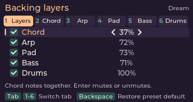
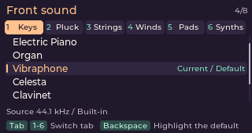

# ZeroChord user guide

Play a chord with one hand and pick or strum its notes with the other. The
**front** is what you play on `Z`–`M`. **Backing** is what the chord buttons play
through Chord, Arp, Pad, Bass, and Drums.

## Contents

- [Make your first sound](#make-your-first-sound)
- [Choose and combine chords](#choose-and-combine-chords)
- [Set up backing layers](#set-up-backing-layers)
- [Customize your front notes](#customize-your-front-notes)
- [Find and edit settings](#find-and-edit-settings)
- [Shape your sound](#shape-your-sound)
- [Import your own sounds](#import-your-own-sounds)
- [Keyboard reference](#keyboard-reference)
- [Troubleshooting](#troubleshooting)

## Make your first sound

Open **ZeroChord** from APPLaunch. The default preset is **Dream**, in the key
of **C**. The app starts silently until you play.

1. Press `8` for a C major chord.
2. Play `Z` `X` `C` `V` `B` `N` `M` to pick its notes. `L` strums up. `K` strums down.
3. Try `8` → `5` → `T` → `4` for C → G → Am → F in the default key of C.
4. Press `O` to choose backing layers. `I` toggles **Hold**.
5. Press `Space` to stop sound. Hold `Esc` for about a second to save your
   settings and return to the launcher.

The **chord grid** shows a degree and root above each column. The **front row**
shows the note and octave above each key.

See [installation](../README.md#install) if you need to set up the app and the
[keyboard reference](#keyboard-reference) for all shortcuts.

## Choose and combine chords

### Pick a chord

Choose a column for the root and a row for the quality. The grid labels the
rows **M** for major, **m** for minor, and **7** for seventh. These are the
labels when the key is C.

| Row | II · D | III · E | IV · F | V · G | VI · A | VII · B | I · C |
| --- | --- | --- | --- | --- | --- | --- | --- |
| **M** Major | `2` | `3` | `4` | `5` | `6` | `7` | `8` |
| **m** Minor | `Q` | `W` | `E` | `R` | `T` | `Y` | `U` |
| **7** Seventh | `A` | `S` | `D` | `F` | `G` | `H` | `J` |

### Add a chord quality, a sharp, or a bass note

Press buttons **in the same column** together for richer harmonies. The
default 30 ms window groups nearby presses into one attack.

| Press together | Default quality | Example in C |
| --- | --- | --- |
| Top + middle | Diminished | `8` + `U` |
| Top + bottom | Major seventh | `8` + `J` |
| Middle + bottom | Minor seventh | `U` + `J` |
| All three | Augmented | `8` + `U` + `J` |

- **Raise a chord by a semitone.** Hold `1`, then select the chord. Its root
  and bass rise, and it stays selected at that pitch after you release `1`.
  The **+1** indicator and grid show what the next chord selection will use.
- **Choose a different bass note.** In the default key, hold `8` and press `5`
  to play C major over G. The first column sets the chord and the second sets
  the bass note.

### Change the key or chord layout

Open **App → Chord config**. Press `Tab` for the next tab, `1` for **All**, or
`2`–`8` to select the degree shown on the playing grid.

| Scope | What you can change |
| --- | --- |
| **All** | Key, Scale, shared octave, Hold, chord combinations, and combo timing (Off or 5–120 ms) |
| **A degree** | Its octave, absolute root, and chord combinations |

**Scale** sets the chord roots from a seven-note scale: Major, Natural minor,
Harmonic minor, Melodic minor, Dorian, Mixolydian, Lydian, or Phrygian. Each
choice lists the roots it gives in the current key. In **Natural minor**, III,
VI, and VII sit a semitone lower (in C: E♭, A♭, B♭). The M / m / 7 rows keep
their qualities.
**Follow All** restores the shared octave. **Follow Key** restores the root
for the current key. These mappings apply across presets. See the
[chord configuration reference](FRONT_NOTES.md#chord-config) for combo timing
and [additional chord qualities](FRONT_NOTES.md#choose-a-chord-quality).

## Set up backing layers

Press `O` or open **Style → Backing layers**. The **Layers** tab lists Chord, Arp,
Pad, Bass, and Drums. Use `F` / `X` (↑ / ↓) to pick a layer, `Enter` to mute or unmute it, and
`Z` / `C` (← / →) to set its mix. Changes apply at once, even while a chord
plays. A layer at **0%** is silent. Raising a muted layer unmutes it.
`Backspace` restores the layer's preset mix. `Esc` returns to playing.

Every built-in preset starts with all five layers selected, so **Style →
Backing layers** and the `O` hint read **All layers**. Each style sets its own
sound, pattern, envelope, and level for every layer. Your own and edited presets
keep their settings; those from before 1.4 start Bass and Drums selected at 0%.

| Layer | What you hear when you select a chord |
| --- | --- |
| **Chord** | Chord notes together, with a single hit, a sustained chord, or a rhythm |
| **Arp** | Chord tones played one at a time in a repeating pattern |
| **Pad** | A soft continuous chord with optional volume motion |
| **Bass** | A bass line on the chord's root, or its slash bass, an octave or two below |
| **Drums** | A drum groove on the beat while a chord sounds. It ignores the chord's notes. |
| **None** | Front only. The chord selects the harmony for `Z`–`M`, `K`, and `L` silently. |

Layers share tempo and harmony. Each mix is a fader of its own: 100% is full
level and 50% is about 12 dB quieter. ZeroChord matches the loudness of each
sound, so a mix means the same whatever sound the layer plays. **Backing
volume** sets all five together.

### Pick a pattern and tempo

The **Chord**, **Arp**, **Pad**, and **Bass** tabs of **Backing layers** each
hold that layer's **Pattern** (or **Motion**), **Sound**, and **Envelope**. Chord
and Pad also have **Voicing**. The **Drums** tab holds **Kit** and **Pattern**.
Press `Tab` for the next tab, or `1`–`6` to jump to one, as numbered on screen.
`Enter` opens the list of patterns, sounds, voicings, or kits.

- **Chord pattern.** Choose **Manual hit** for one strike, **Sustained** for a
  continuous chord, or a rhythm such as **Every beat**, **Offbeat**, **Pop strum**,
  **Chords on 2 and 3**, **Rock eighths**, or **Bossa accompaniment**. Bass events
  sound an octave below the chord. Guitar and harp sounds strum their chords: down
  on the beat, and up, quicker and softer, between the beats. Nylon guitar stays
  fingerpicked.
- **Voicing.** Choose how Chord or Pad spreads the chord's notes. **Close** stays
  near middle C and moves to the nearest notes of the next chord. **Open** spreads
  them wide. **Power** plays root, fifth, and octave. **Rich** adds 9ths and 7ths
  and leaves out the root. Chord starts on Close and Pad on Open. While the Bass
  layer plays, full Chord and Pad hits leave the root to the bass. Power chords
  and a pattern's single root note keep it.
- **Arp pattern.** Try **Up**, **Down**, **Up / down**, **Root and upper notes**,
  **Broken eighths**, **Syncopated notes**, **Broken 3/4**, **Sixteenths up**, or
  **Two octaves**. Older mixed patterns appear only for presets that use them.
  The Arp plays an octave above the chord.
- **Pad motion.** Add movement to the Pad's volume.
- **Bass pattern.** Choose **Root notes**, **Held root**, **Root and fifth**,
  **Driving eighths**, **Octave pulse**, **Offbeat**, **Syncopated**,
  **Bossa nova**, or **Waltz 3/4**.
- **Drum kit.** Choose **Standard**, **Room**, **Power**, **Electronic**,
  **TR-808**, **Jazz**, **Brush**, or **Orchestra**. Kits from a sound pack
  follow them in the same list. A short low thump sounds under each built-in
  kick.
- **Drum pattern.** Choose **Basic beat**, **Pop**, **Rock**, **R&B groove**,
  **Half-time**, **Four on the floor**, **Bossa nova**, **Waltz 3/4**,
  **Brushes**, or **Chimes** (bells and a soft shaker, with no kick or snare).
  Drums have no envelope or key.

Press `P`, or select **Style → Tempo** and press `Enter`. The page has three
rows. Use `F` / `X` (↑ / ↓) to move between them.

| Row | What it does |
| --- | --- |
| **Tempo** | Type 40 to 240 BPM and press `Enter` to apply it. Typing digits always returns to this row. |
| **Swing** | **Off**, **8ths**, or **16ths**. `Enter` or `Z` / `C` (← / →) step through them. |
| **Swing amount** | `Z` / `C` (← / →) set 0–100% in 5% steps; 50% by default. Dimmed while Swing is Off. |

Swing and Swing amount apply at once. At 0% the notes are straight; at 100% they have
a full triplet feel. **8ths** delays the "and" of each beat, and **16ths** delays
every second 16th note. Every style starts with swing Off. `R` loads the preset
tempo and swing. `Esc` keeps the swing and drops a tempo you typed but did not
apply. `Backspace` on **Style → Tempo** restores the tempo and swing. The Tempo
row reads, for example, **100 BPM** or **100 BPM, 8ths swing 60%**, and the `P`
hint adds **swing** when it is on.

### Keep a chord ringing after release

1. Unmute **Chord** in **Backing layers → Layers**.
2. Turn on **Hold** with `I` or open **App → Chord config → All → Hold**.
3. Choose **Backing layers → Chord → Pattern → Sustained**.

**Hold** keeps the harmony selected after you release the chord buttons.
**Sustained** keeps the Chord sound ringing too. **Manual hit** plays once.
With **Hold** off, releasing the chord buttons stops the backing. Hold also
keeps the bass and drums going; `Space` stops them.

## Customize your front notes

Open **App → Front notes → All** to choose which notes `Z`–`M` play and what
`K` and `L` do. Each mode remembers its own **K/L action**.

| Front mode | What `Z`–`M` play |
| --- | --- |
| **Chord notes** | Notes from the selected chord and its quality |
| **Scale notes** | Notes from the front key's scale, playable before choosing a chord |

| K/L action | `K` | `L` |
| --- | --- | --- |
| **Strum** | Sweep `M` → `Z` | Sweep `Z` → `M` |
| **Octave shift** | Shift front notes down | Shift front notes up |

**Strum time** sets the duration of the whole sweep. On each key's tab, choose
its note and octave. In **Scale notes** mode, **Key** and **Scale** on the
**All** tab follow **Chord config** by default. Choose either to set the front's
own key, and press `Backspace` to follow the chord again. The front **Scale**
also offers Major pentatonic, Minor pentatonic, and Blues. These have fewer
notes than keys, so the last keys continue into the next octave.

Hold `1` to raise newly played front notes one semitone, even when the chord
root is already sharp. The displayed front notes show the pitches you will play
next. Ringing notes and queued strums keep their starting pitches. See the
[front-note reference](FRONT_NOTES.md#each-key) for the mapping and octave options.

## Find and edit settings

Press `Tab` to open settings. Inside, the keys work the same on every page:

- `Tab` moves to the next tab, and `1`–`8` jump to a numbered tab. The bottom
  line shows `Tab` and the range, such as `1-6`, on pages with tabs.
- `F` / `X` (↑ / ↓) move between rows.
- `Z` / `C` (← / →) change a number right away, such as a level, time, tempo,
  or octave; ◂ ▸ mark it. Hold an arrow to repeat, faster after a moment.
- `Enter` opens rows marked `>`: a page, the list of choices for an option such
  as a sound or key, or an action. Restore and save actions ask once: `Enter` to
  do it, `Esc` to keep.
- A preview plays while you stay on its option and stops when you leave it.
- `Backspace` restores the option to its default. When the bottom line is
  full, its hint shortens to **Restore preset default** or **Restore default**.
  `Esc` goes back, and closes settings from the top.

The line below the rows says what the highlighted option does. In a list,
**Current** marks the active value and **Default** marks the value that
`Backspace` highlights. Press `Enter` to apply a highlighted choice.

| Tab | What it affects |
| --- | --- |
| **Style** | **Settings for this preset** covers tempo and swing, backing layers and mix, patterns, sounds, and envelopes |
| **App** | **Applies to all presets** covers theme, volume and effects, chord config, and front notes |
| **About** | The installed version and a QR code to the repository and documentation |

The About QR code works in either theme. Open it on a phone with internet access.

### Switch, copy, or restore a preset

- **Switch.** Press `9` / `0` to move between presets: Dream, Pop, R&B, Rock,
  Waltz, Bossa, Dance, and your own. Each remembers its edits.
- **Copy.** Choose **Style → Save as new preset** to create an editable copy.
- **Restore.** Choose **Style → Restore preset** and confirm to reset that preset.
  To reset one setting, use `Backspace` on its row.
- **Check for edits.** An asterisk (`*`) marks a changed preset or setting.
  Hold `Esc` to save recent edits and return to the launcher.

See the [preset guide](PRESETS.md) for editable files and built-in defaults.

## Shape your sound

### Balance the mix and add effects

Open **App → Volume & effects**. These controls apply to every preset.

| Control | What it changes | Default |
| --- | --- | --- |
| **System Vol** | Device output, including other apps, on PulseAudio-compatible systems | Current system level |
| **App Vol** | Complete ZeroChord output, including Echo | 100% |
| **Backing volume** | Chord, Arp, Pad, Bass, and Drums together | 80% |
| **Front volume** | Picked notes and strums | 100% |
| **Echo** | Level of the repeats, a dotted eighth apart in time with the tempo | 15% |
| **EQ Low / Mid / High** | Bass, middle, and treble of the whole mix, from −12 to +12 dB | 0 dB |
| **Output** | **Auto**, **Speaker**, or **Headphones**. Press `Enter` for the list. | Auto |

Use `F` / `X` (↑ / ↓) to select a row and `Z` / `C` (← / →) to adjust it.
Changes apply immediately in 5-point steps for volume and Echo, or 1 dB steps
for EQ. The audio system manages **System Vol**. ZeroChord saves **App Vol**
with its app settings.

**Speaker** suits the small built-in speaker: it adds octave harmonics of the
bass so you can hear the bass line, gives the drums a little click, and leaves
out the lowest notes (below about 70 Hz) that the speaker cannot play.
**Headphones** plays the full range. **Auto** follows the headphone jack and
shows **Auto (speaker)** or **Auto (headphones)**. When the jack is unknown, as in
the desktop preview, it shows **Auto** and plays the full range.

Each style places its parts left and right and adds its own reverb. A limiter
keeps loud passages from clipping. Try **Low +3 dB** for a fuller sound. If the
sound distorts, reduce the boost or lower **App Vol**. Press `Backspace` to
reset the selected EQ band. Set **Echo** to **0%** for a dry sound.

### Control how a note starts and ends

Open **Envelope** on a **Backing layers** tab, or in **Style → Front sound**.
Chord, Arp, Pad, Bass, and Front each have their own sound and envelope.
**Style → Front sound → Level** sets the front's level in this style, from 0 to
100% in 5% steps, like a layer mix.

| Control | What you hear |
| --- | --- |
| **Attack** | How quickly a note rises to full level |
| **Decay** | How quickly it falls to the held level |
| **Sustain** | The level while the note is held |
| **Release** | How long it fades after you let go |

A front note sounds while you hold its key, and **Release** starts when you let
go. Each picker lists the sound's own value among the others and marks the
preset's choice as **Default**. Chord, Arp, and Bass limit the sound's own attack and
release for clearer backing. A one-shot sound ends when its recorded sample runs
out.
**Restore envelope** resets the selected part. See the
[sound and envelope reference](PRESETS.md#sound-and-envelope-order) for ranges
and how to save custom values.

## Import your own sounds

1. Put a **SoundFont (.sf2)** file or a sound pack in `ZeroChord/sounds/` on the
   TF card, or in `~/ZeroChord/sounds/`.
2. Restart ZeroChord.
3. Open **Sound** in **Style → Front sound** or on a **Backing layers** tab.
   Sounds are grouped as Keys, Plucked (shown as **Pluck**), Strings, Winds,
   Pads, and Synths. Plain SF2 files appear under **Custom**. A pack can name
   its sounds and set their categories. Pack drum kits appear in
   **Backing layers → Drums → Kit**.

The [sound pack guide](../sounds/README.md) covers supported locations, manifests,
size limits, and the optional Grand Piano, Synths, and Drums downloads. Use sounds with licenses
that allow your intended use.

## Keyboard reference

### While playing

| Key | Action |
| --- | --- |
| `2`–`8` / `Q`–`U` / `A`–`J` | Select a major / minor / seventh chord |
| `Z`–`M` | Play the seven front notes; each sounds and stays lit while held |
| `K` / `L` | Strum down / up, or shift the octave down / up when configured |
| `9` / `0` | Previous / next preset |
| `1` + chord | Raise the chord root and bass by one semitone |
| `I` | Toggle **Hold** |
| `O` | Open **Backing layers** to mute and mix Chord, Arp, Pad, Bass, and Drums |
| `P` | Type a tempo and set swing |
| `Tab` | Open settings |
| `Space` | Stop backing, bass, drums, front notes, and queued strums |
| Hold `Esc` | Save changes and return to the launcher |

### In settings

| Key | Action |
| --- | --- |
| `Tab` | Next tab, or next sound group in a sound list |
| `1`–`8` | Jump to a numbered tab or sound group; the bottom line shows the range |
| `Z` / `C` (← / →) | Change the highlighted number. Hold to repeat. |
| `F` / `X` (↑ / ↓) | Move between rows or choices. Hold to repeat. |
| `Enter` | Open a page or list, or confirm |
| `Esc` | Cancel, go back, or close settings |
| `Backspace` | Restore a field or highlight its default in a list |

Dedicated arrow keys also work in settings. Hold `Esc` to exit from any page.

## Troubleshooting

| Symptom | Try |
| --- | --- |
| **Silent on startup** | Press `8`. ZeroChord starts silently. |
| **Chord button is silent** | Press `O` to check the backing layers. Check **Backing volume**, **App Vol**, and **System Vol**. |
| **Chord fades with Hold on** | Set **Backing layers → Chord → Pattern → Sustained**. **Manual hit** plays once. |
| **No bass or drums** | Press `O`, select **Bass** or **Drums**, and raise its mix. Your own or edited presets from before 1.4 start them at 0%. |
| **Bass is hard to hear** | On the speaker, check that **App → Volume & effects → Output** is **Speaker** or **Auto (speaker)**. Try **EQ Low +3 dB**, or compare through headphones. |
| **Sound distorts** | Reduce EQ boosts or turn down **App Vol**. |
| **A chord combination attacks twice** | In **App → Chord config → All**, increase **Chord combo timing** slightly. |
| **An imported sound is missing** | Restart and check the [sound pack formats and limits](../sounds/README.md). |
| **Recent edits disappeared** | Hold `Esc` to exit and save settings before turning off the device. |

For development and verification, see the [build guide](DEVELOPMENT.md) and
[testing guide](TESTING.md).
