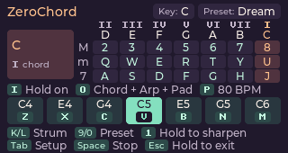
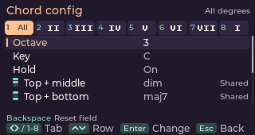

# ZeroChord user guide

Play a chord with one hand and pick or strum its notes with the other. The
**front** is what you play on `Z`–`M`. **Backing** is what the chord buttons play
through Chord, Arp, or Pad.

## Contents

- [Make your first sound](#make-your-first-sound)
- [Choose and combine chords](#choose-and-combine-chords)
- [Set up backing layers](#set-up-backing-layers)
- [Customize your front notes](#customize-your-front-notes)
- [Find and edit settings](#find-and-edit-settings)
- [Shape your sound](#shape-your-sound)
- [Import your own sounds](#import-your-own-sounds)
- [Keyboard reference](#keyboard-reference)
- [Troubleshooting](#troubleshooting)

## Make your first sound

Open **ZeroChord** from APPLaunch. The default preset is **Dream**, in the key
of **C**. The app starts silently until you play.

1. Press `8` for a C major chord.
2. Play `Z` `X` `C` `V` `B` `N` `M` to pick its notes. `L` strums up. `K` strums down.
3. Try `8` → `5` → `T` → `4` for C → G → Am → F in the default key of C.
4. Press `O` to choose backing layers. `I` toggles **Hold**.
5. Press `Space` to stop sound. Hold `Esc` for about a second to save your
   settings and return to the launcher.

The **chord grid** shows a degree and root above each column. The **front row**
shows the note and octave above each key.

See [installation](../README.md#install) if you need to set up the app and the
[keyboard reference](#keyboard-reference) for all shortcuts.

## Choose and combine chords

### Pick a chord

Choose a column for the root and a row for the quality. The grid labels the
rows **M** for major, **m** for minor, and **7** for seventh. These are the
labels when the key is C.

| Row | II · D | III · E | IV · F | V · G | VI · A | VII · B | I · C |
| --- | --- | --- | --- | --- | --- | --- | --- |
| **M** Major | `2` | `3` | `4` | `5` | `6` | `7` | `8` |
| **m** Minor | `Q` | `W` | `E` | `R` | `T` | `Y` | `U` |
| **7** Seventh | `A` | `S` | `D` | `F` | `G` | `H` | `J` |

### Add a chord quality, a sharp, or a bass note

Press buttons **in the same column** together for richer harmonies. The
default 30 ms window groups nearby presses into one attack.

| Press together | Default quality | Example in C |
| --- | --- | --- |
| Top + middle | Diminished | `8` + `U` |
| Top + bottom | Major seventh | `8` + `J` |
| Middle + bottom | Minor seventh | `U` + `J` |
| All three | Augmented | `8` + `U` + `J` |

- **Raise a chord by a semitone.** Hold `1`, then select the chord. Its root
  and bass rise, and it stays selected at that pitch after you release `1`.
  The **+1** indicator and grid show what the next chord selection will use.
- **Choose a different bass note.** In the default key, hold `8` and press `5`
  to play C major over G. The first column sets the chord and the second sets
  the bass note.

### Change the key or chord layout

Open **App → Chord config**. Use `Z` / `C` (← / →) to switch tabs, `1` for
**All**, or `2`–`8` to select the degree shown on the playing grid.

| Scope | What you can change |
| --- | --- |
| **All** | Key, shared octave, Hold, chord combinations, and combo timing (Off or 5–120 ms) |
| **A degree** | Its octave, absolute root, and chord combinations |

**Follow All** restores the shared octave. **Follow Key** restores the root
for the current key. These mappings apply across presets. See the
[chord configuration reference](FRONT_NOTES.md#chord-config) for combo timing
and [additional chord qualities](FRONT_NOTES.md#choose-a-chord-quality).

## Set up backing layers

Press `O` or open **Style → Backing layers**. Use `F` / `X` (↑ / ↓)
to move and `Enter` to toggle a layer. Select **Apply** to save the choices
together. `Esc` cancels. `Backspace` or `R` selects the preset defaults
for you to confirm.

| Layer | What you hear when you select a chord |
| --- | --- |
| **Chord** | Chord notes together, with a single hit, a sustained chord, or a rhythm |
| **Arp** | Chord tones played one at a time in a repeating pattern |
| **Pad** | A soft continuous chord with optional volume motion |
| **None** | Front only. The chord selects the harmony for `Z`–`M`, `K`, and `L` silently. |

Turn on several layers to combine them. They share tempo and harmony. ZeroChord
balances their levels to leave room for the front notes. Your harmony stays
selected when you apply new layers.

### Pick a pattern and tempo

In **Style**, change **Chord pattern**, **Arp pattern**, and **Pad motion**
independently.

- **Chord pattern.** Choose **Manual hit** for one strike, **Sustained** for a
  continuous chord, or a rhythm such as **Every beat**, **Offbeat**, or **Bossa accompaniment**.
  Bass events sound an octave below the chord.
- **Arp pattern.** Try **Up**, **Down**, **Up/down**, **Root and upper notes**,
  **Broken eighths**, or **Syncopated notes**. Older mixed patterns still play using chord tones.
- **Pad motion.** Add movement to the Pad's volume.

Press `P` or open **Style → Tempo**. Type a value from 40 to 240 BPM and press
`Enter` to apply. `R` fills in the preset tempo.

### Keep a chord ringing after release

1. Enable **Chord** in **Backing layers**.
2. Turn on **Hold** with `I` or open **App → Chord config → All → Hold**.
3. Choose **Style → Chord pattern → Sustained**.

**Hold** keeps the harmony selected after you release the chord buttons.
**Sustained** keeps the Chord sound ringing too. **Manual hit** plays once.
With **Hold** off, releasing the chord buttons stops the backing.

## Customize your front notes

Open **App → Front notes → All** to choose which notes `Z`–`M` play and what
`K` and `L` do. Each mode remembers its own **K/L action**.

| Front mode | What `Z`–`M` play |
| --- | --- |
| **Chord notes** | Notes from the selected chord and its quality |
| **Scale notes** | Notes from the current key's major or natural minor scale, playable before choosing a chord |

| K/L action | `K` | `L` |
| --- | --- | --- |
| **Strum** | Sweep `M` → `Z` | Sweep `Z` → `M` |
| **Octave shift** | Shift front notes down | Shift front notes up |

**Strum time** sets the duration of the whole sweep. On each key's tab, choose
its note and octave. In **Scale notes** mode, select **Scale** on the **All** tab.

Hold `1` to raise newly played front notes one semitone, even when the chord
root is already sharp. The displayed front notes show the pitches you will play
next. Ringing notes and queued strums keep their starting pitches. See the
[front-note reference](FRONT_NOTES.md#each-key) for the mapping and octave options.

## Find and edit settings

Press `Tab` to open settings. Use `Z` / `C` to switch tabs and `F` / `X` to
move between rows. The hint row shows the keys for the current page. In a picker,
**Current** marks the active value and **Default** marks the value that
`Backspace` highlights. Press `Enter` to apply a highlighted choice.

| Tab | What it affects |
| --- | --- |
| **Style** | **Settings for this preset** covers tempo, backing layers, patterns, sounds, and envelopes |
| **App** | **Applies to all presets** covers theme, volume and effects, chord config, and front notes |
| **About** | The installed version and a QR code to the repository and documentation |

The About QR code works in either theme. Open it on a phone with internet access.

### Switch, copy, or restore a preset

- **Switch.** Press `9` / `0` to move between presets. Each remembers its edits.
- **Copy.** Choose **Style → Save as new preset** to create an editable copy.
- **Restore.** Choose **Style → Restore preset** and confirm to reset that preset.
  To reset one setting, use `Backspace` on its row.
- **Check for edits.** An asterisk (`*`) marks a changed preset or setting.
  Hold `Esc` to save recent edits and return to the launcher.

See the [preset guide](PRESETS.md) for editable files and built-in defaults.

## Shape your sound

### Balance the mix and add effects

Open **App → Volume & effects**. These controls apply to every preset.

| Control | What it changes | Default |
| --- | --- | --- |
| **System Vol** | Device output, including other apps, on PulseAudio-compatible systems | Current system level |
| **App Vol** | Complete ZeroChord output, including Echo | 100% |
| **Backing volume** | Chord, Arp, and Pad together | 80% |
| **Front volume** | Picked notes and strums | 100% |
| **Echo** | Level of the repeat, about 230 ms after the original note | 15% |
| **EQ Low / Mid / High** | Bass, middle, and treble of the whole mix, from −12 to +12 dB | 0 dB |

Use `F` / `X` (↑ / ↓) to select a row and `Z` / `C` (← / →) to adjust it.
Changes apply immediately in 5-point steps for volume and Echo, or 1 dB steps
for EQ. The audio system manages **System Vol**. ZeroChord saves **App Vol**
with its app settings.

Try **Low +3 dB** for a fuller sound. If the small speaker distorts, reduce the
boost or lower **App Vol**. Press `Backspace` to reset the selected EQ
band. Set **Echo** to **0%** for a dry sound.

### Control how a note starts and ends

In **Style**, open the envelope for **Front**, **Chord/Arp**, or **Pad**.
Chord and Arp share a sound and envelope.

| Control | What you hear |
| --- | --- |
| **Attack** | How quickly a note rises to full level |
| **Decay** | How quickly it falls to the held level |
| **Sustain** | The level while the note is held |
| **Release** | How long it fades after you let go |

Choose **Use sound's envelope** for the sound's own decay and sustain. Chord/Arp
also limits the default attack and release for clearer backing. A one-shot
sound ends when its recorded sample runs out.
**Restore envelope** resets the selected part. See the
[sound and envelope reference](PRESETS.md#sound-and-envelope-order) for ranges
and how to save custom values.

## Import your own sounds

1. Put a **SoundFont (.sf2)** file or a sound pack in `ZeroChord/sounds/` on the
   TF card, or in `~/ZeroChord/sounds/`.
2. Restart ZeroChord.
3. Open a **Front sound**, **Chord/Arp sound**, or **Pad sound** picker in Style.
   Plain SF2 files appear under **Custom**. A pack can name its sounds and set
   their categories.

The [sound pack guide](../sounds/README.md) covers supported locations, manifests,
size limits, and the optional Grand Piano download. Use sounds with licenses
that allow your intended use.

## Keyboard reference

### While playing

| Key | Action |
| --- | --- |
| `2`–`8` / `Q`–`U` / `A`–`J` | Select a major / minor / seventh chord |
| `Z`–`M` | Pick the seven front notes |
| `K` / `L` | Strum down / up, or shift the octave down / up when configured |
| `9` / `0` | Previous / next preset |
| `1` + chord | Raise the chord root and bass by one semitone |
| `I` | Toggle **Hold** |
| `O` | Open **Backing layers** |
| `P` | Type a tempo |
| `Tab` | Open settings |
| `Space` | Stop backing, front notes, and queued strums |
| Hold `Esc` | Save changes and return to the launcher |

### In settings

| Key | Action |
| --- | --- |
| `Z` / `C` (← / →) | Switch tabs or sound groups, or adjust the selected Volume & effects value |
| `F` / `X` (↑ / ↓) | Move between rows or choices |
| `Enter` | Open a page or confirm a choice |
| `Esc` | Cancel a choice or go back |
| `Backspace` | Restore a field or highlight its default in a picker |

Dedicated arrow keys also work in settings. Hold `Esc` to exit from any page.

## Troubleshooting

| Symptom | Try |
| --- | --- |
| **Silent on startup** | Press `8`. ZeroChord starts silently. |
| **Chord button is silent** | Press `O` to check the backing layers. Check **Backing volume**, **App Vol**, and **System Vol**. |
| **Chord fades with Hold on** | Set **Style → Chord pattern → Sustained**. **Manual hit** plays once. |
| **Bass is hard to hear** | Try **EQ Low +3 dB**, or compare through headphones. |
| **Sound distorts** | Reduce EQ boosts or turn down **App Vol**. |
| **A chord combination attacks twice** | In **App → Chord config → All**, increase **Chord combo timing** slightly. |
| **An imported sound is missing** | Restart and check the [sound pack formats and limits](../sounds/README.md). |
| **Recent edits disappeared** | Hold `Esc` to exit and save settings before turning off the device. |

For development and verification, see the [build guide](DEVELOPMENT.md) and
[testing guide](TESTING.md).
